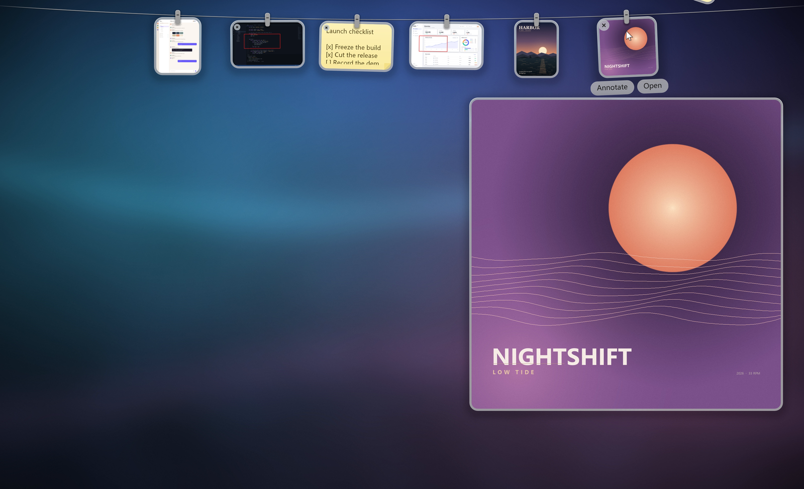

# Pegline

**Your screenshots, hanging where you can reach them.**

Pegline is a small Windows app that keeps screenshots and notes on a clothesline
along the top edge of the screen. Push the pointer against the top edge and the
line slides down; move away and it tucks back up. Hover a card to see it full
size, click a picture to copy it, click a note to edit it.

<picture>
  <source srcset="docs/demo/pegline-demo.webp" type="image/webp">
  
</picture>

<sub>Recorded on Windows 11 at 200% DPI. The screenshots and note in the demo are
generated for the recording. [Animated WebP](docs/demo/pegline-demo.webp) (1.7 MB).</sub>

## What it does

| You | Pegline |
|:--|:--|
| Push the pointer to the top edge | The line drops into view |
| Hover a card | Shows a full-size preview |
| Click a picture | Copies it; a check confirms |
| Click a note | Opens the Markdown editor |
| Hover a picture, choose **Annotate** | Draw, then save back to the line |

The line stays out of the way: it is always on top, click-through everywhere
except a card, and never takes focus from what you are doing. There is no
installer and no background service.

## Notes are Markdown

```markdown
# Launch checklist

- [x] Freeze the build
- [x] Cut the release
- [ ] Record the demo

> Small, light, fast.

`pegline.exe` · 1.8 MB
```

The editor renders headings, lists, task lists, quotes, bold and italic text,
inline code, code blocks, links and horizontal rules as you type; Chinese text
works too. The card keeps a compact preview, and every note stays a plain
`.txt` file you can open anywhere.

## Small, light, fast

| | |
|:--|:--|
| **Download** | a single `pegline.exe`, **1.8 MB** (790 KB zip) |
| **Memory** | **~66 MB** at rest; **~97 MB** with six screenshots on the line |
| **Startup** | **~0.1 s** to the tray |
| **Animation** | **~60 fps** on the line; targets 60–120 Hz displays |
| **Capture** | 200 screenshots in a row settle at **+3.7%** memory |
| **Runtime** | none — no installer, no .NET, no Electron |

Measured on the reference machine (Windows 11, 200% DPI). The method and the
raw numbers are in [PLAN.md](PLAN.md) §3.3 and §11.

## Get Pegline

Pegline runs on Windows 10 and 11 (x64). The current release is **2.5.0**
(2026-11-12); see [docs/RELEASE-2.5.0.md](docs/RELEASE-2.5.0.md).

1. Download the portable zip from the [Releases page](https://github.com/2829632740/Pegline/releases),
   or build the package with `pwsh tools\package-release.ps1`.
2. Unzip it anywhere and run `pegline.exe`.
3. It starts in the tray. Press **Ctrl+Alt+K** to snip; screenshots copied to
   the clipboard or saved in your screenshots folder appear on the line.

Change the shortcut, sounds and language from the tray menu. Settings, notes
and the line live in `%APPDATA%\Pegline` and `%LOCALAPPDATA%\Pegline`, and the
UI ships in English, Spanish and Chinese.

## Under the hood

Pegline is native Windows code: Rust, Win32 and DirectComposition, with D3D11
and Direct2D for drawing. There is no Electron, no .NET and no WPF in the
shipping app.

The line is a GPU swap chain composited by DWM. Hit-testing uses the same
layout math as drawing, so the window stays click-through except over a card.
Springs integrate by real frame `dt` against an 8.3 ms budget, shadows are
baked once, and the render loop does not allocate per frame.

Measured with the `probe` binary on the same machine:

| | |
|:--|:--|
| `--mode=line` | 97.0 MB private, 59.95 fps, draw p50 1.635 ms |
| `--mode=static` | 66.0 MB private |
| Cold start to tray | 105–107 ms |
| 200 captures in a row | +3.7% memory after settling |

Verified at 60 Hz on one 200% DPI display. A 120 Hz panel, a second monitor
and sleep/wake are still on the hardware test list.

### Build from source

```powershell
cargo build --release          # target\release\pegline.exe
cargo test                     # pure logic only
cargo clippy --all-targets -- -D warnings
cargo fmt --check
cargo run --bin probe -- --mode=flight
```

Build the portable package with `pwsh tools\package-release.ps1`.

Development switches: `--demo` hangs three generated cards, `--editor-demo`
opens the annotation editor on a generated picture, `--note-preview-demo`
hangs a note with its hover preview ready, and `PEGLINE_LANG=en|es|zh` forces
a UI language. Stress the capture pipeline with
`pwsh tools\stress.ps1 -Count 200` while the release build is running.

## Documents

| | |
|:--|:--|
| [PLAN.md](PLAN.md) | milestones, performance budget, measurements, next steps |
| [CHANGELOG.md](CHANGELOG.md) | what changed in 2.5.0 and earlier |
| [docs/RELEASE-2.5.0.md](docs/RELEASE-2.5.0.md) | current release notes and checksum |
| [docs/BEHAVIOR.md](docs/BEHAVIOR.md) | the complete behavioural spec |
| [docs/ARCHITECTURE.md](docs/ARCHITECTURE.md) | target architecture |
| [docs/DECISIONS.md](docs/DECISIONS.md) | implementation choices and rejected optimisations |
| [docs/VISUAL-TESTS.md](docs/VISUAL-TESTS.md) | visual acceptance evidence |
| [docs/PARITY.md](docs/PARITY.md) | acceptance checklist for the port |
| [AGENTS.md](AGENTS.md) | working notes for agents |

## Lineage

Pegline is a Windows port of [Tendedero](https://github.com/alejandrobujan/tendedero).
The name and the icon are not covered by the upstream licence, so this port has
its own. The original C# / WPF implementation is frozen under
[`archive/wpf-v1/`](archive/wpf-v1/) and remains the behavioural reference.

## Licence

MIT. See [LICENSE](LICENSE).
