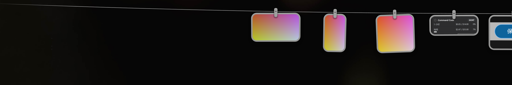

# Pegline-Rust

**把截图挂在屏幕顶部的晾衣绳上。** · Screenshots, strung on a clothesline at the top of your screen.

[](https://github.com/hermitalap/Pegline-Rust/actions/workflows/ci.yml)
[](https://github.com/hermitalap/Pegline-Rust/releases/latest)
[](LICENSE)
[](https://github.com/hermitalap/Pegline-Rust/releases/latest)



## 这是什么

Pegline-Rust 是 [Pegline](https://github.com/2829632740/Pegline) 的 **Rust 重写版**，本仓库 fork 自原项目。
原项目用 C# / WPF 写成，单文件、零依赖；这个仓库用 **Win32 + DirectComposition + Direct2D** 重写了
从渲染到截图的整条链路，保持同样的行为，换取更低的常驻开销、稳定的帧率和单文件分发。

指针顶到屏幕上沿，绳子滑下来；移开，绳子收回去。截图从被截取的位置飞上绳子，可以复制、打开、
标注、拖进文件夹保存，或拖进回收站丢掉。

> 上游关系：Pegline 是 [Tendedero](https://github.com/alejandrobujan/tendedero)（macOS，作者
> Alejandro Buján）的 Windows 移植；Pegline-Rust 是 Pegline 的 Rust 重写。原 WPF 实现不在本仓库中，
> 仍由[上游项目](https://github.com/2829632740/Pegline)维护。

## 功能

- **挂绳**：贴屏幕顶部、始终置顶；只有图片区域接收鼠标，其余点击穿透，不抢焦点。
- **截图**：托盘一键截图（调用 Win+Shift+S）、监听截图文件夹、粘贴剪贴板图片；重复截图自动合并。
- **卡片**：单击复制（图片 + 文件）、双击打开、右键菜单；悬停显示大图预览；拖进应用、文件夹或回收站。
- **标注编辑器**：箭头、矩形、文字（支持中文输入法）、马赛克、橡皮擦，5 种颜色、3 档线宽，撤销 / 重做。
- **便签**：在纸面上直接写 Markdown，四种纸色，悬停预览，编辑后飞回绳子。
- **托盘与快捷键**：截图 / 便签快捷键可录制，开机启动、音效、挂绳常驻、清空截图，en / es / zh 三语。
- **观感**：取自壁纸的 Mica 玻璃、真实弹簧动画、逐显示器 DPI、跟随显示器刷新率的帧循环。

## 下载

[**最新版本**](https://github.com/hermitalap/Pegline-Rust/releases/latest) ·
下载 `Pegline-<version>-win-x64.zip`，解压后运行 `pegline.exe`。

- 单文件、绿色版：约 1.8 MB，无需安装，也不需要 .NET 或 VC++ 运行时。
- 系统要求：Windows 10 1809+ / Windows 11，x64。
- 数据位置：设置与日志在 `%APPDATA%\Pegline`，便签在 `%LOCALAPPDATA%\Pegline`，与 WPF 版共用，
  可以直接互换。
- 每个 zip 旁边有 `.sha256` 校验文件。

## 从源码构建

需要 **Rust 1.85+**（stable、MSVC 工具链）和 Windows SDK（`rc.exe` 用来嵌入图标与 manifest）。

```powershell
cargo build --release          # target\release\pegline.exe
cargo test                     # 纯逻辑测试
cargo clippy --all-targets -- -D warnings
cargo fmt --check
```

生成便携发布包（会先跑测试和 clippy，并校验嵌入的版本资源与 `Cargo.toml` 一致）：

```powershell
pwsh tools\package-release.ps1
```

产物是 `dist\Pegline-<version>-win-x64.zip` 和对应的 `.sha256`。

## 开发

- `cargo run --bin probe -- --mode=line`：测量帧率、绘制耗时与私有内存
  （另见 `--mode=flight|static|idle|timer`）。
- `--demo` 挂三张生成卡片；`--editor-demo` 打开标注编辑器；`--note-preview-demo` 预览便签；
  `--panic-test` 验证崩溃日志。`PEGLINE_LANG=en|es|zh` 强制界面语言。
- `pwsh tools\stress.ps1 -Count 200`：连续截图压测。

## 仓库结构

| 路径 | 内容 |
|:--|:--|
| `src/` | 应用（`main.rs`、`app/`、`window/`、`editor/`、`note_editor/`、…）与测量工具 `probe` |
| `assets/` | 图标、DPI manifest、资源脚本、Lucide 工具图标 |
| `docs/` | 行为规范、架构、实现决策、技术栈与截图 |
| `tools/` | 打包、压测与可视化检查脚本 |
| `.github/workflows/` | CI 与发布流水线 |

## CI / CD

- **CI**（`.github/workflows/ci.yml`）：每次 push 到 `main` 和每个 PR，在 `windows-latest` 上跑
  `cargo fmt --check`、`clippy -D warnings`、`cargo test` 和 release 构建。
- **Release**（`.github/workflows/release.yml`）：推送 `v*` 标签时校验标签与 `Cargo.toml` 版本一致，
  打包 zip + sha256，提取 `CHANGELOG.md` 对应段落，用 `gh` 创建 GitHub Release。

## 文档

| 文档 | 内容 |
|:--|:--|
| [docs/BEHAVIOR.md](docs/BEHAVIOR.md) | 完整的用户可见行为规范（数值来自 WPF 原版） |
| [docs/ARCHITECTURE.md](docs/ARCHITECTURE.md) | 线程模型与 Win32 + DirectComposition 架构 |
| [docs/DECISIONS.md](docs/DECISIONS.md) | 实现决策、被否决的优化与被修正的行为 |
| [docs/RUST-STACK.md](docs/RUST-STACK.md) | 工具链、crate、构建与打包约定 |
| [CHANGELOG.md](CHANGELOG.md) | 版本变更记录 |

> 文档目前为中文；行为规范是 Rust 版与 WPF 版逐条对照的依据。

## 许可证

MIT，见 [LICENSE](LICENSE)。Pegline 的名字和图标不在 Tendedero 的授权范围内，因此 Windows 移植使用了
自己的名字和图标；本仓库沿用 Pegline 的名字与图标。

---

**English** — Pegline-Rust is a fork of [Pegline](https://github.com/2829632740/Pegline): a Windows tray app
that hangs screenshots on a clothesline at the top of the screen. This repository is a Rust rewrite
(Win32 + DirectComposition) of the original C#/WPF app, shipped as a single portable executable, MIT
licensed. See the [docs](docs/) for behaviour, architecture and decisions.
