# Liquid Glass ring probe

2026-11-09. Experiment only: `src/bin/probe/glass.rs`, `probe --mode=glass` and
`src/bin/glass_demo.rs`; no app code changed.

## Why

A Pegline picture card is a 144x112 DIP frame: a 72% `#F7F7F7` fill, a 0.75 DIP
top-lit gradient stroke, and a baked shadow. The frame is 4 DIP wide, around a
136x104 DIP photo.

[LiquidGlass](https://github.com/OverShifted/LiquidGlass) (MIT) gets its look
from a superellipse lens: the ring samples the background it covers, magnifies
it toward the outer edge, adds an angular highlight and a little grain. The
prior session asked for a probe-only experiment before any production work:
draw that ring over a real photo at 100% and 200% DPI, in four variants, so the
decision is made from images rather than an argument.

## Method

The renderer is a CPU reference implementation, not a D3D11 pass. `Renderer`
targets a swap chain and exposes no offscreen target, and the device helpers in
`src/gfx/device.rs` are crate-private; a probe-only D3D pass would duplicate
device creation, HLSL compilation and readback. The ring math is the same, and
the existing WIC encoder writes the PNGs. This answers the visual question; it
does not measure GPU cost.

- Sample: crop `(200,1380)-(1200,2145)` of
  `docs/visual/note-rehang-unchanged.jpg` (the owl at the 136:104 photo aspect).
- Card: 144x112 DIP, radius 16, photo 136x104 DIP at radius 12, ring 4 DIP.
- 100% output: 720x360; 200% output: 1440x720, a true 2x composition.
- Background: dark gradient, a 24 DIP grid and a vignette; the shadow is an
  analytic rounded-rect falloff approximating the app's baked shadow.
- Detail: a 4x nearest-neighbour crop of the card's top-left 48x40 DIP, placed
  next to the 1:1 card. The 200% detail has twice the source pixels and is
  placed at twice the size, so the 200% file is exactly 2x the 100% file.

### Variants

| Variant | Ring |
| --- | --- |
| `off` | The app today: 72% `#F7F7F7` fill and a 0.75 DIP top-lit stroke. |
| `glow` | `off` plus the LiquidGlass angular highlight, a broad top-left sheen and the inner dark/bright lines. No photo sampling. The D2D-only option. |
| `refract` | A clear ring: up to 13 DIP of the photo (the 4 DIP ring plus 9 DIP) is compressed into the frame, with +/-0.5 DIP channel dispersion, a 1 DIP stroke and the inner lines. |
| `all` | `refract` + `glow` + a little grain. The full effect. |

## Images

The 200% files are shown at 50% here so both scales occupy the same width; open
the 200% file at 100% to see the actual 8 px ring. Each pair is the same scene.

### 100%

| `off` | `glow` |
| --- | --- |
| 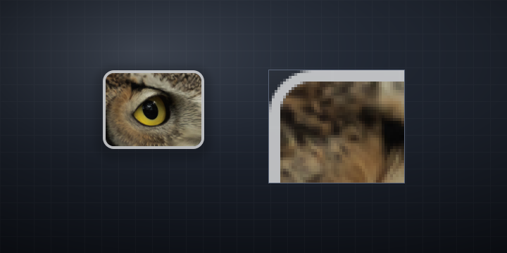 | 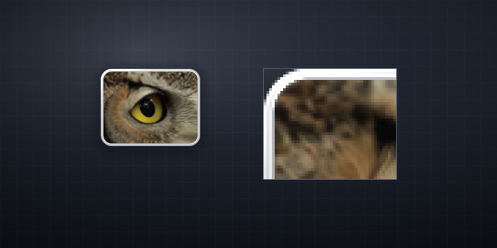 |

| `refract` | `all` |
| --- | --- |
| 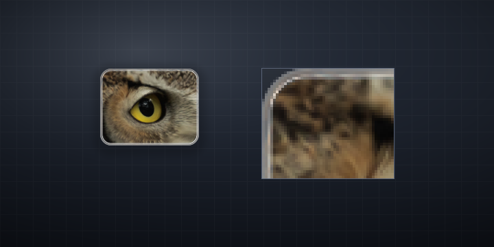 | 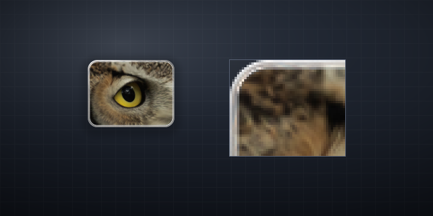 |

### 200% (shown at 50%)

| `off` | `glow` |
| --- | --- |
| 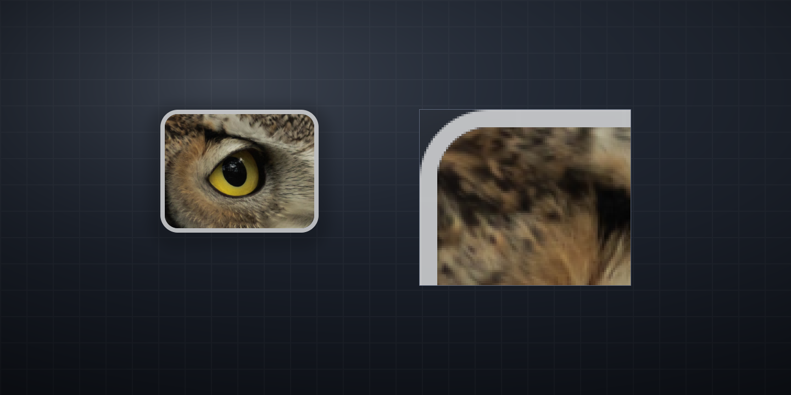 | 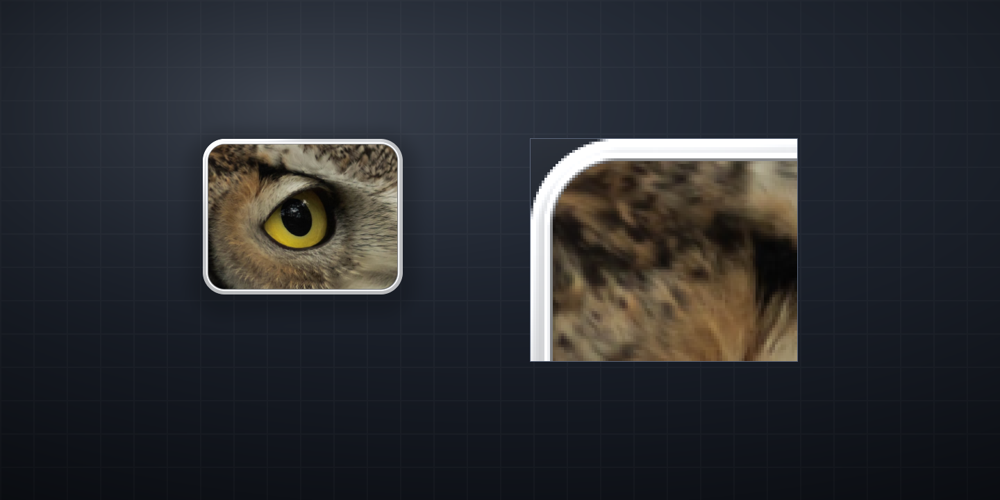 |

| `refract` | `all` |
| --- | --- |
| 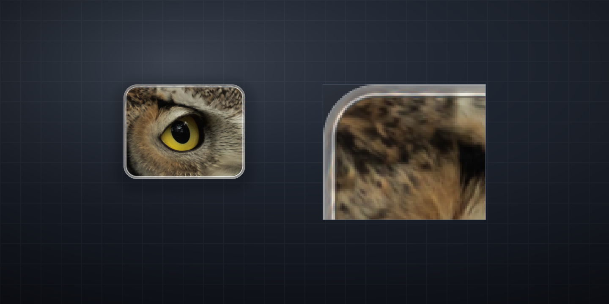 | 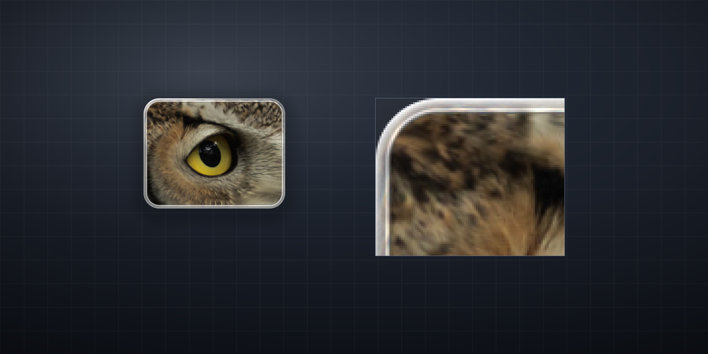 |

The eight files:

- `docs/visual/liquid-glass-off-100.png`, `docs/visual/liquid-glass-off-200.png`
- `docs/visual/liquid-glass-glow-100.png`, `docs/visual/liquid-glass-glow-200.png`
- `docs/visual/liquid-glass-refract-100.png`, `docs/visual/liquid-glass-refract-200.png`
- `docs/visual/liquid-glass-all-100.png`, `docs/visual/liquid-glass-all-200.png`

## GPU demo

`src/bin/glass_demo.rs` is the full-surface experiment: a normal window with a
D3D11 swap chain, a Direct2D panel and an HLSL port of the LiquidGlass shader.
It is still an experiment; no app code uses it.

- Scene: 1400x900 DIP (2800x1800 at 200%). A 440 DIP superellipse reference
  lens at (300,300), a 560x160 DIP thick capsule at (300,700), three 200x52
  action capsules, five 64x64 tool circles, a colour capsule and a 12-slider
  panel.
- Background: live desktop captured with GDI `BitBlt` into a top-down DIB and
  uploaded to a D3D11 texture about 15 times per second. `--photo` uses the owl
  crop instead; `B` toggles. The demo is excluded from the capture only while
  the app itself runs `BitBlt` (`WDA_EXCLUDEFROMCAPTURE`, then `WDA_NONE`), so
  the window still appears in the user's own screenshots.
- GPU: a background pass, a two-pass 9-tap separable blur at half resolution,
  then one alpha-blended glass pass and the D2D panel. The lens uses the
  reference `p * f(dist)` mapping; the capsules use the same `f` as an inward
  normal offset, because a global radial scale would smear the ends of a long
  stadium.
- The sliders are live: blur, tint, edge tint, noise, dispersion, magnify,
  power, `f` power, glow, light angle, shininess and edge width. `R` resets.
- Measured on the 6016x3384 / 192 dpi display: 59-60 fps at 2800x1800 with the
  photo fallback, 58 fps at 1400x900, and about 42 fps at 2800x1800 with the
  live GDI capture. The live capture is the limiter, not the glass pass.

```powershell
cargo build --release --bin glass_demo
.\target\release\glass_demo.exe              # 2x on this 192 dpi display
.\target\release\glass_demo.exe --scale=1    # 100% pixels
.\target\release\glass_demo.exe --photo      # photo fallback
.\target\release\glass_demo.exe --shot=target\gpu.png --shot-exit
```

`--shot` reads the back buffer before `Present` and writes a PNG; it works even
while the window is excluded from the screen capture. The first 30 frames are
allowed to settle so the fps field is meaningful.

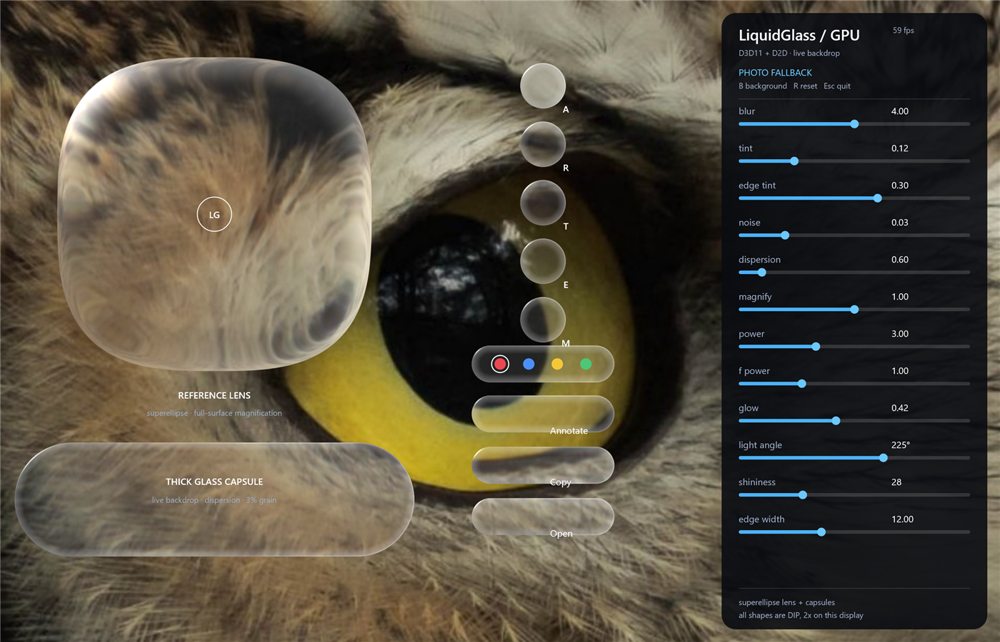

[100% pixels](visual/glass-gpu-1x.png) and
[live desktop](visual/glass-gpu-live.png). The earlier CPU picker is
`visual/glass-demo.png`; it is superseded by this GPU scene.

Limitations: the live background is a GDI copy, not a real desktop-capture GPU
path; it is one frame behind and currently ~15 Hz. The swap chain uses a
single-buffer `DXGI_SWAP_EFFECT_DISCARD` because the flip-model buffers failed
on this machine. The capsule mapping is an approximation, and this is not a
production integration or a cost measurement for Pegline's line.

The 1400x900 image above is a bicubic downscale of the 2800x1800 capture; the
100% link is natively 1400x900.

## What the images show

- At 100% the ring is 4 physical px. The effect is mostly visible at the
  corners and the top edge; the card itself is 144 px wide, so the frame is a
  thin line at the viewing distance of the real line.
- At 200% the ring is 8 px and the bevel reads clearly. This is where the
  LiquidGlass model looks like glass rather than a white border.
- `off` is a flat frosted frame: legible, but it has no thickness. `glow` keeps
  the white fill and adds a white ceramic bevel and an inner seam; it stays
  legible on the dark background. `refract`/`all` turn the frame into a clear
  pearl bevel: the photo edge visibly bleeds into the ring, the top-left is
  bright, and the bottom/right goes dark and translucent. At 1:1 the clear
  frame loses edge contrast against a dark desktop; the white `off` frame is
  easier to read.
- The highlight and the inner lines do most of the visible work. The refraction
  is subtle at 4 DIP, and the 136x104 photo thumbnail (272x208 at 200%) has
  little detail for the compressed band; most of what it adds is a soft tint and
  a dark inner seam.
- The probe images are a look test. The GPU demo above is the performance
  reference for the demo scene, not for Pegline's line: the current line draws
  in 0.80 ms p50 (probe `--mode=line`), so the production pass still has to be
  measured against that.

## Recommendation

The GPU demo exists to choose the capsule treatment; the card recommendation
below still applies to the 4 DIP ring. The user's tuned parameters go further
than the original `glow` recommendation: the branch uses a clear refracting ring
with a fixed top-left highlight. The branch section below records that
approximation and its limits.

1. Adopt `glow` (the L1 layer) in D2D first: keep the 0.75 DIP top-lit stroke,
   add the angular highlight and the inner dark/bright lines, with the current
   72% fill as the fallback. It is the part that improves both scales, needs no
   new device or pipeline, and keeps the card legible.
2. Do not build a D3D11 pass for the 144 DIP card from this experiment alone.
   At 4 DIP the refraction is a nuance, and it would need the full-resolution
   photo (not the 136 DIP thumbnail) to avoid a soft band. That is a larger
   change than the border is worth today.
3. Revisit the clear ring for larger glass surfaces where it has room and a real
   backdrop: the hover preview, the annotation editor's floating pills and the
   note editor. A 12-16 DIP glass edge is a different problem from a 4 DIP card
   border, and the probe should be repeated there with a GPU pass.
4. If a GPU pass is approved later, measure it on the 200% display and the Intel
   machine before/after: draw p50, frame p50/p95 and private memory, with the
   current D2D frame as the fallback.

## Current direction

The GPU demo is the current ideal-look experiment: full superellipse lens and
capsule lenses over a live desktop, a D3D11/D2D pipeline, GPU specular and live
sliders. The pointer-following highlight was tried and dropped: it read oddly
and required a whole-scene re-render on every move. It is replaced by the
reference's fixed top-left highlight and a broad rim.

The remaining production decision is not the shader formula but the backdrop.
The card frame must keep its content sharp, so only the 4 DIP ring can refract.
A floating capsule over the desktop has no owned backdrop: the demo can capture
the desktop behind it, but a production overlay would need a capture path,
permissions and a cost budget, or a synthetic/frozen backdrop. The card and
capsule treatments in this demo are therefore an upper bound on the look, not a
ready integration.

## Main app branch

The branch `feat/liquid-glass-visual` ports the tuned look into the app as a
CPU/D2D approximation, not a D3D11 pass. The GPU demo above remains the exact
reference; the branch exists to judge the scheme in the real windows without
duplicating a device, swap chain and shader into the line, preview, flight,
ghost, editor and note editor.

The tuned values are the slider screenshot the user supplied: blur 8.00, tint
0.00, edge tint 0.10, noise 0.00, dispersion 1.00, magnify 1.00, power 2.83,
f power 1.50, glow 0.20, light angle 225 degrees, shininess 2, edge width 9.00.

Implemented on the branch:

- **Line photo cards.** `src/glass.rs::card_overlay` bakes the 4 DIP ring from
  the decoded thumbnail at the card's physical size; `Card.glass` keeps the
  uploaded bitmap, and `draw_card` draws it over a sharp photo instead of the
  flat glass fill and stroke. The centre stays transparent so the photo is
  never blurred.
- **Line action capsules.** When a card is hovered, `ensure_action_glass`
  captures the desktop behind the action row with the overlay window excluded,
  bakes both capsules with `capsule_overlay` (stadium lens, frosted crop,
  dispersion, fixed top-left specular, seam) and caches them. Labels are drawn
  white with an ink shadow so they survive a dark backdrop.
- **Editor pills.** `paint_pill` bakes a capsule from the desktop behind the
  editor, excluding the editor window; tool circles, the colour capsule and
  action buttons reuse that per-size cache. Selection and hover accents remain
  vector so they stay crisp.
- **Hover preview and drag ghost.** Both generate a card ring from their source
  image before uploading and skip the old glass fill/stroke when it exists.

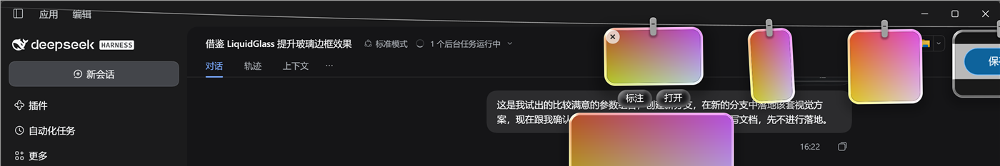

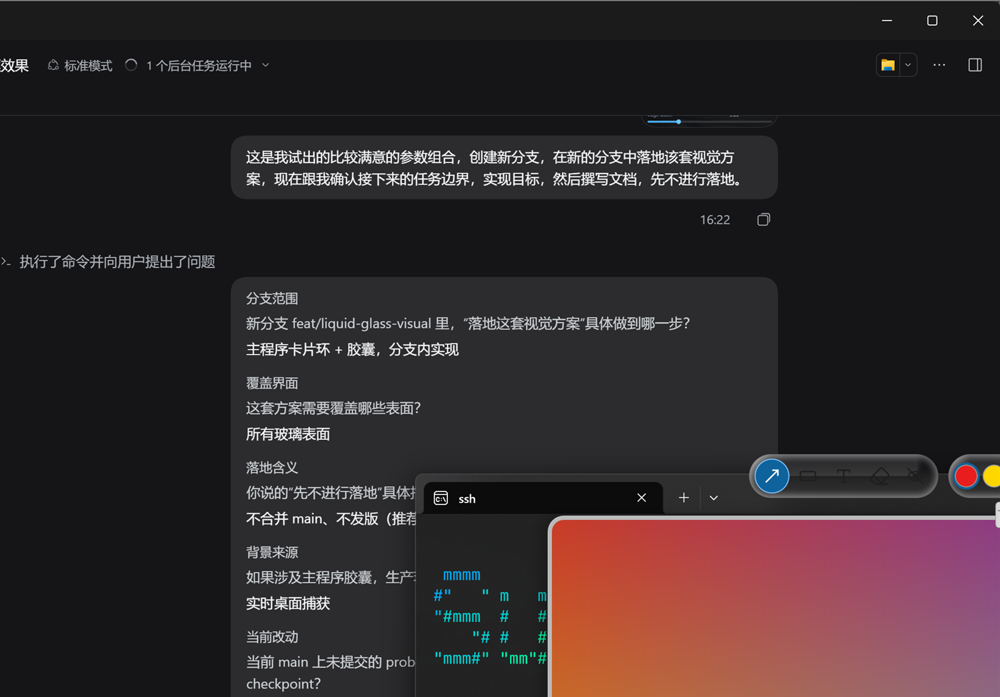

Not yet on the tuned path: note cards and the note peek, the Copied pill, the
note swatch pill, the hint, the flight card, the note editor card frame and the
annotation editor's own card frame. They still use the 72% `#F7F7F7` fill and
0.75 DIP stroke, so the branch is deliberately a contrast test rather than a
complete replacement. These are listed in `PLAN.md` as the next branch step.

Limitations to keep visible:

- The branch is CPU + D2D. The card ring is baked once per image; the capsules
  are baked from a frozen capture and are not updated as the desktop changes.
- The capsule capture is the same desktop capture the GPU demo uses. The
  overlay window is excluded only for the duration of the `BitBlt`, so ordinary
  screenshots still include the window.
- The card ring has no blur: the photo is content and must stay legible. The
  LiquidGlass body blur applies to the capsules, where the backdrop is not
  content.
- The capsule backdrop is real desktop pixels; if capture fails, the old glass
  fill is the fallback. That fallback is also what unsupported surfaces use.
- No merge and no release on this branch; the point is the visual decision.

## Reproduce

```powershell
cargo build --release --bin probe
.\target\release\probe.exe --mode=glass
```

It writes the eight PNGs into `docs/visual/` in about 0.45 s. It creates no
window and no device; it needs the owl sample at
`docs/visual/note-rehang-unchanged.jpg`.
