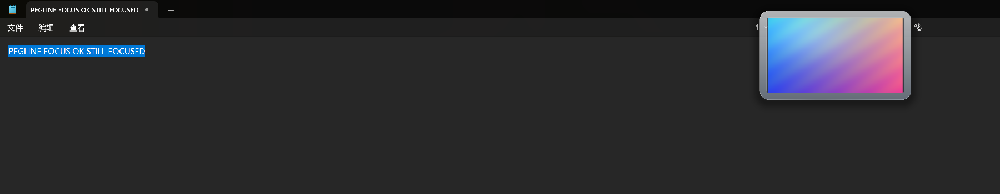
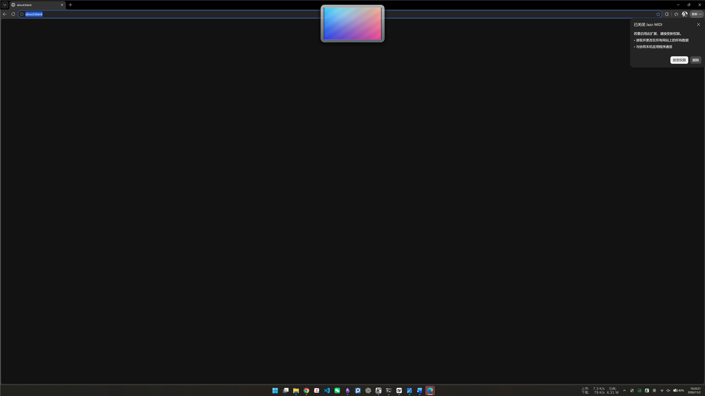

# SPIKE-01 结果：透明合成窗口（M0）

状态：**通过（继续）** — 2026-11-02 — 同一台机器、同一次开机内完成。

结论：`WS_EX_NOREDIRECTIONBITMAP` + DirectComposition + `CreateSwapChainForComposition`
在 Intel Arc B390 / 6016×3384 @200% / 60 Hz 上可用；预乘 alpha 正确透出桌面，
圆角外无黑底/白边；跨线程 DComp（UI 建 visual、渲染线程建交换链并 `SetContent`/`Commit`）
可用。60 Hz 两种尺寸都满帧；本机没有 120 Hz 显示模式，按规格用 `--nolimit` 验证单帧绘制，
远低于 8 ms。**没有阻塞 M1 的问题。**

M0 发现并修正了一处实现细节：在这台 Windows 11 上，仅靠 `WS_EX_TRANSPARENT` 或
`WM_NCHITTEST` 返回 `HTTRANSPARENT` 不足以把点击穿透到**其他进程**的窗口
（`HTTRANSPARENT` 只沿同一线程的窗口链传递）。跨进程点击穿透需要同时设置
`WS_EX_TRANSPARENT | WS_EX_LAYERED`。这里的 `WS_EX_LAYERED` 只作为输入透明标志，
没有重定向位图，也没有 `UpdateLayeredWindow`，像素仍然来自 DComp 交换链。加上它之后
static 私有内存仍是 37.8–38.2 MB，和未加时一致。

---

## 1. 机器与环境

| 项 | 值 |
|:--|:--|
| OS | Microsoft Windows 11 专业版 10.0.26300（build 26300，64 位） |
| CPU | Intel Core Ultra X7 358H，16 核 / 16 线程 |
| 机器 | Xiaomi Book Pro 14，31.5 GB RAM |
| GPU | Intel(R) Arc(TM) B390 GPU，驱动 32.0.101.8359 |
| 屏幕 | 6016×3384，工作区 6016×3288，单屏，主屏 |
| 缩放 | 200%（192 DPI，Per-Monitor V2） |
| 刷新率 | 60.00 Hz（DWM timing）；帧间隔 p50 16.66 ms |
| 120 Hz 模式 | 当前分辨率下没有；`EnumDisplaySettingsW` 枚举到的最大值为 60 Hz |
| 工具链 | Rust 1.96.1 stable，`x86_64-pc-windows-msvc`，Edition 2024 |
| 构建 | `cargo build --release`，`+crt-static`，LTO thin，`codegen-units=1`，`strip=symbols` |
| 产物 | `pegline.exe` 236,032 B；`spike.exe` 428,544 B |
| CRT | 静态；`dumpbin /dependents` 无 `vcruntime140.dll` / `msvcp140.dll` |
| 清单 | 已内嵌 Per-Monitor V2、`longPathAware`、Win10/11 supportedOS |

显示器由 DWM 报告为 60.00 Hz；`--nolimit` 时不再受垂直同步限制，测得的是绘制/提交吞吐。

---

## 2. 实现概要

- 窗口：`WS_POPUP` + `WS_EX_NOREDIRECTIONBITMAP | WS_EX_TOOLWINDOW | WS_EX_NOACTIVATE |
  WS_EX_TOPMOST`。不抢焦点：`WM_MOUSEACTIVATE` 返回 `MA_NOACTIVATE`，`ShowWindow(SW_SHOWNOACTIVATE)`。
- 点击穿透：`--clickthrough=1` 时额外加 `WS_EX_TRANSPARENT | WS_EX_LAYERED`；
  `WM_NCHITTEST` 对非卡片区域返回 `HTTRANSPARENT`（同线程双保险）。
- DirectComposition：UI 线程创建 D3D11 device、DComp device、target、root visual，
  `target.SetRoot` + `Commit`；渲染线程创建 `IDXGISwapChain1`（FLIP_SEQUENTIAL、BGRA8、
  PREMULTIPLIED、2 缓冲）、D2D device/context，然后 `visual.SetContent(swapchain)` + `Commit`。
  这是 ARCHITECTURE §12.6 的跨线程验证。
- D2D 内容：圆角 16 DIP 玻璃卡片、1 px 渐变边框、代码生成的测试纹理（compact 480×270，
  flight 1600×1600）、预烘焙九宫格阴影（160 DIP，启动时烘焙一次，320×320 @200%）。
- 动画：弹簧按真实 `dt` 积分，内部 1/240 s 子步；目标每 2.5 s 翻转一次，位移 ±200 DIP；
  帧循环用 `Present(1, 0)` 跟随垂直同步，代码里没有 16.6 ms 常数。
- 每帧不分配堆内存：画刷、纹理、九宫格、目标位图全部缓存；统计缓冲启动时预分配。
- 无 GPU 回读；没有整窗 CPU 光栅；阴影不是每帧模糊。
- 窗口 6016×420（compact）或 2442×2344（flight）；两套交换链尺寸都实测。

---

## 3. 验收结果（SPIKE-01 §4）

| # | 项 | 结果 | 实测 / 证据 |
|:--|:--|:--|:--|
| 1 | 透明合成 | **通过** | 卡片+阴影之外采样 51,569 点，与无覆盖参考**全部逐像素一致**（最大通道和差 0）；卡片内 231/231 点有明显差异。圆角外没有黑底/白边。见 §5.1。 |
| 2 | 点击穿透 | **通过** | `clickthrough=1`：下层不抢焦点目标收到 1 次点击，spike `clicks=0 mouseactivate=0`；`clickthrough=0`：目标 0 次，spike `clicks=1 mouseactivate=1`。见 §5.2。 |
| 3 | 不抢焦点 | **通过** | 点击卡片前后前台 HWND 都是 Notepad；`activations=0 focus=0`；点击后继续输入并 Ctrl+A/C，剪贴板为 `PEGLINE FOCUS OK STILL FOCUSED`。见 §5.3。 |
| 4 | 置顶 | **通过** | 覆盖最大化的 Edge 窗口；`topmost=true`（`WS_EX_TOPMOST` + `SetWindowPos(HWND_TOPMOST)`）。见 §5.4。 |
| 5 | 6016×420 @60 | **通过** | `fps=60.07`，`p50=16.66`，`p95=16.99`，`max=18.55`，`jank=0.00%`，`cpu_ms_frame=0.719`，private 40.4 MB。 |
| 6 | 2442×2344 @60 | **通过** | `fps=60.06`，`p50=16.66`，`p95=16.95`，`max=18.21`，`jank=0.00%`，`cpu_ms_frame=0.659`，private 63.6 MB。 |
| 7 | 120 Hz 能力 | **通过（按无 120 Hz 屏的回退）** | 本机无 120 Hz 模式。`--nolimit`：animate 3004 fps / draw p95 0.065 ms / draw max 0.575 ms；flight 951 fps / draw p95 0.102 ms / draw max 0.510 ms。单帧绘制远低于 8 ms。 |
| 8 | CPU | **通过** | animate 0.719 ms/帧，flight 0.659 ms/帧（均 ≤2）；static 重绘 0.029 ms，20 s 空闲 CPU 0.31%（折合每显示帧约 0.052 ms，≤0.1）。 |
| 9 | 内存 | **通过** | static private **37.9 MB**（≤40）；flight **63.6 MB**（≤80）；animate 40.4 MB；工作集分别 52.5 / 78.1 MB。 |
| 10 | 稳定性 | **通过** | 连续 300 s animate：60.02 fps，p95 16.97 ms，jank 0.00%，device_lost=0；private 35.3 → 40.4 MB 后持平（max=last=40.4），无持续增长。见 §4.3。 |
| 11 | 跨线程 | **通过** | UI 线程建 `IDCompositionTarget`/`IDCompositionVisual`；渲染线程建交换链、`SetContent`、`Commit` 全部成功，日志 `dcomp=cross-thread`，无 `RPC_E_WRONG_THREAD`。不需要退化方案。 |

---

## 4. 测量明细（同一次开机）

原始输出保存在 `target/spike-artifacts/final-*.log`（不入库）。

### 4.1 60 Hz

| mode | 尺寸 | frames | fps | p50 ms | p95 ms | max ms | jank | cpu ms/帧 | private | ws |
|:--|:--|--:|--:|--:|--:|--:|--:|--:|--:|--:|
| static（1 帧后空闲 20 s） | 6016×420 | 1 | 0.00 | 0.00 | 0.00 | 0.00 | 0.00% | 0.029（draw scope） | 37.9 MB | 52.5 MB |
| animate | 6016×420 | 3605 | 60.07 | 16.66 | 16.99 | 18.55 | 0.00% | 0.719 | 40.4 MB | 54.9 MB |
| flight | 2442×2344 | 3604 | 60.06 | 16.66 | 16.95 | 18.21 | 0.00% | 0.659 | 63.6 MB | 78.1 MB |

绘制耗时（BeginDraw → EndDraw）：

| mode | draw p50 ms | draw p95 ms | draw max ms |
|:--|--:|--:|--:|
| static | 0.029 | 0.029 | 0.029 |
| animate | 0.195 | 0.283 | 0.872 |
| flight | 0.195 | 0.281 | 1.080 |

`static` 只画一帧，然后不进入帧循环；`cpu_ms_frame` 的 `cpu_scope=draw` 用 QPC 测得该帧的
绘制时间。Windows 的 `GetProcessTimes` 对单帧低于 15.6 ms 计时粒度，不能用来除 1；
20 s 的空闲进程 CPU 是 0.31%，折合每个显示周期约 0.052 ms，仍低于 0.1 ms/帧的预算。

### 4.2 120 Hz 替代（`--nolimit`）

| mode | frames | loop fps | frame p50 | frame p95 | draw p50 | draw p95 | draw max | private |
|:--|--:|--:|--:|--:|--:|--:|--:|--:|
| animate | 30049 | 3004.14 | 0.25 ms | 0.34 ms | 0.024 ms | 0.065 ms | 0.575 ms | 41.6 MB |
| flight | 9514 | 951.22 | 0.90 ms | 4.10 ms | 0.042 ms | 0.102 ms | 0.510 ms | 64.7 MB |

`--nolimit` 用 `Present(0, 0)`，不再等垂直同步；这里的 fps 是合成吞吐，不是显示刷新率。
验收只看单帧绘制：两项的 draw max 分别为 0.575 / 0.510 ms，远小于 8 ms；flight 的
frame p95 4.10 ms 也小于 120 Hz 的 8.33 ms 周期。真实 120 Hz 屏的满帧验证留到 M7。

### 4.3 5 分钟稳定性

`--mode=animate --seconds=300`，同一进程、同一次开机：

```text
SPIKE mode=animate w=6016 h=420 hz=60.00 frames=18006 fps=60.02 p50=16.66 p95=16.97 max=19.21 jank=0.00% cpu_ms_frame=0.652 cpu_scope=process private=40.4MB ws=55.5MB draw_p50=0.182 draw_p95=0.272 draw_max=0.941 presented=18006 skipped=0 device_lost=0 clicks=0 activations=0 focus=0 mouseactivate=0 private_first=35.3MB private_min=35.3MB private_max=40.4MB ws_max=61.8MB wall_s=300.01 cpu_pct=3.91% cpu_ms_total=11734.4 nolimit=false
```

- 18006 帧 / 300.01 s = 60.02 fps；p95 16.97 ms；最大 19.21 ms；**jank 0.00%**。
- private 从 35.3 MB 升到 40.4 MB（D2D/DWM 首次使用后的惰性分配），之后 5 分钟保持 40.4 MB
  （`private_max == private`，`ws` 55.5 MB / max 61.8 MB）；**没有持续增长**。
- 设备丢失 0；无进程崩溃、无窗口失效、无掉帧。

---

## 5. 截图

### 5.1 透明合成、圆角与阴影


卡片叠在棋盘格背景上：卡片外完全透出背景，圆角外没有黑底/白边，预烘焙阴影可见。
卡片内是代码生成的 480×270 测试纹理。

定量检查：在卡片+阴影包围盒之外按 17×23 px 网格采样 **51,569 个点**，与无覆盖的参考截图
**全部完全一致**（最大通道和差 0）；卡片内部采样 231 个点，231 个都有明显差异。
卡片边缘向外 24 DIP 的预烘焙阴影按设计会让像素轻微变暗（阴影边缘 2–3/255），阴影之外是精确透明。


### 5.2 点击穿透开/关

`clickthrough=1`：点击穿过卡片，落到下层的 no-activate 目标窗口；目标是 topmost 且
`WS_EX_NOACTIVATE`，所以点击既不会激活它，也不会把 spike 盖住。目标窗口显示
“click received: 1”。


`clickthrough=0`：同一次点击被 spike 自己接收；目标仍是 “click received: 0”。
spike 统计为 `clicks=1 mouseactivate=1 activations=0 focus=0`。


### 5.3 不抢焦点

Notepad 保持前台；点击卡片后继续输入，剪贴板内容为
`PEGLINE FOCUS OK STILL FOCUSED`。卡片盖在最大化 Notepad 的顶部。



### 5.4 覆盖最大化的 Edge



### 5.5 弹簧动画的两个位置

`t≈1 s`：卡片包围盒 x=3138..3680；`t≈3 s`：x=2336..2880。位移约 400 px = 200 DIP，
说明弹簧在按真实 `dt` 运动，且卡片跟随垂直同步更新。


---

## 6. 结论与后续

- **继续 M1。** 透明合成、点击穿透、不抢焦点、置顶、两种尺寸的 60 Hz、跨线程 DComp
  都实测通过；120 Hz 用 `--nolimit` 的单帧预算验证通过。
- **M1 需要带上 `WS_EX_LAYERED`**（与 `WS_EX_TRANSPARENT` 同时）实现跨进程点击穿透；
  动态切换时改完 exstyle 要 `SetWindowPos(..., SWP_FRAMECHANGED)`。不要用
  `UpdateLayeredWindow`，也不要引入重定向位图。
- **没有 120 Hz 屏**：M7 在有 120 Hz 屏的机器上重跑 `--mode=animate|flight`，确认
  `Present(1, 0)` 能跑满 118 fps；本次的 3004/951 fps、0.34/4.10 ms p95 只是上界证据。
- static 私有内存 37.9 MB 已接近 40 MB 门槛，M1 加托盘/设置/日志时要继续盯着；
  6 卡空闲的 60 MB 门槛还有余量，但不要把 6K 交换链再加一份。
- 跨线程 DComp 的退化方案不需要启用；ARCHITECTURE §2 的线程模型不需要改，§3 已补上
  `WS_EX_LAYERED` 的点击穿透说明，§12 已记录 M0 结果。

---

## 7. 复现

```powershell
cargo build --release
cargo test
cargo clippy --all-targets -- -D warnings
cargo fmt --check

.\target\release\spike.exe --mode=static  --seconds=20
.\target\release\spike.exe --mode=animate --seconds=60
.\target\release\spike.exe --mode=flight  --seconds=60
.\target\release\spike.exe --mode=animate --seconds=10 --nolimit
.\target\release\spike.exe --mode=flight  --seconds=10 --nolimit
.\target\release\spike.exe --mode=animate --seconds=300
```

点击穿透需要两个进程同时跑：一个 `--clickthrough=1`（或 `0`）的 spike，和一个位于卡片下方、
不抢焦点的目标窗口；本次用 `target/spike-artifacts/clicktarget.ps1` 的临时 WinForms 目标
（不入库）。所有截图都是 6016×3384 物理像素，按区域裁剪/缩放。
