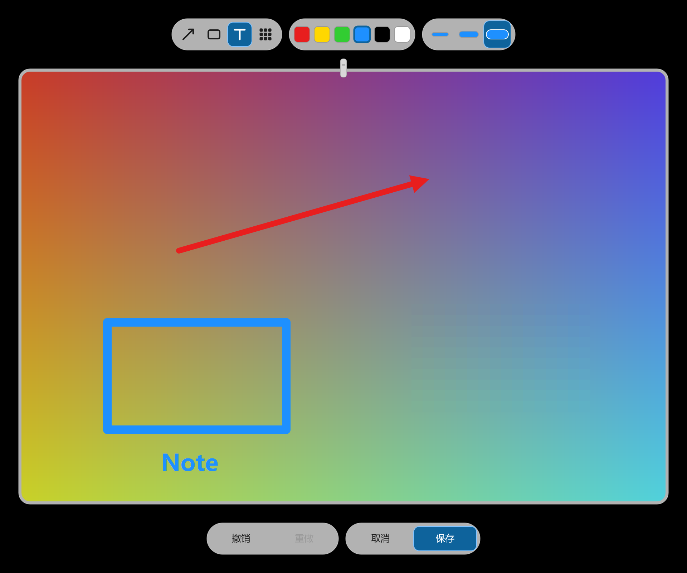

# 视觉与交互验收记录（2026-11-03）

本轮只做“看得见”的验收：在真实桌面上运行 release 版，逐项截图、逐帧录屏，
并把发现的问题修掉。硬件仍是 **6016×3384 @200% / 60 Hz / 单屏**；120 Hz、
第二块屏和休眠唤醒仍无法在本机实测。

## 1. 方法

- 截图：`tools/backdrop.ps1` 铺一层中性灰渐变（可带网格），线带、卡片、预览
  和拖拽 ghost 都对着已知背景看，避免壁纸颜色干扰。
- 动画：`ffmpeg -f gdigrab -framerate 60` 录局部区域，再用
  `-fps_mode passthrough` 抽帧；逐帧量卡片/绳子的位置，而不是只看“感觉”。
- 数值：`probe.exe --mode=line|flight|static`，同一台机器、release 构建。
- 每个交互都用 `SendInput`/`SendMessage` 在真实进程上触发；日志
  （`PEGLINE_TRACE=1` 或 `%APPDATA%\Pegline\trace.on`）记录命中、拖拽、
  飞行/掉落和快捷键窗口。

## 2. 证据

| 图 | 验证的内容 |
|:--|:--|
|  | 悬停后的叉/复制/打开、按钮下方的预览、相框和夹子阴影；预览不再盖住按钮 |
|  | 点击卡片后的“✓ 已复制”胶囊；按钮同时让位 |
|  | 便签正文、折角、四色色板和选中勾；这是在文件夹里已有、但不在线上的便签被重新挂回 |
|  | 点击蓝/粉/灰三色后纸面、折角、墨色和勾选立即切换；`settings.ini` 记录并重启恢复 |
|  | 连续加 13 张后线上保持 12 张、间距 174 DIP 居中，最旧一张掉落 |
|  | 自己保存的截图：保存到桌面 / 丢弃 |
|  | 外部图片：取下 / 移到回收站（没有保存到桌面/丢弃） |
|  | 0.9 倍、0.85 不透明度、跟随指针的 ghost；线带上的原卡变半透明 |
|  | 掉落中的卡片带完整白框和夹子，按 `e = k³` 加速、旋转、淡出 |
|  | 飞行中的截图；相框和夹子随进度淡入，落地前与线上卡片重合 |
|  | 2026-11-05 起：无标题栏的放大挂图（玻璃圆角边框 + 挂夹 + 阴影），工具/颜色/线宽与撤销/取消/保存在卡片外沿的五枚漂浮玻璃胶囊里 |
|  | 文字工具：白底输入框、彩色边框和插入光标；输入框盖住旧箭头，回车后框消失，只留下文字 |
|  | 中文正文“中文测试”输入、字体回退和光标定位都正确 |
|  | `WM_IME_CHAR` 与 `WM_CHAR` 各注入 `0x4E2D`，文字工具出现“中中” |
|  | 真实拼音 `zhongwen` + 空格，文字工具上屏“中文” |
|  | 修复前：组合串和候选列表停在屏幕左上角，压在浏览器标签栏上 |
|  | 修复后：组合串和候选列表紧跟文字框光标，落在屏幕 (2890,1703) |
|  | 剪贴板没有文字时按 `Ctrl+Alt+N`：系统气泡显示“剪贴板里没有文字…”和当前快捷键 |
|  | 冲突提示：红字完整显示在按钮上方；录制时本程序的全局热键已全部释放 |
|  | 西语标题、两行说明和三个按钮完整，无截断 |
|  | 按住 Ctrl+Alt 时只显示 `Ctrl+Alt`，不再出现 `VK00` |
|  | 首次运行 1.2 s 后出现“让 Pegline 接管你的截图吗？”；点“是”后 `catchClipboard=1` |
|  | 从任务栏溢出面板左键点击 Pegline 图标，空线带放下并显示提示 |
|  | 真实右键托盘图标：菜单、热键被占用提示、“接管截图”勾选完整 |
|  | 上：修复前线带压在蓝色全屏窗口上；下：修复后全屏窗口保持干净 |
|  | 绿色窗口在下方：空白处点击落到窗体（日志 50,400），卡片上的点击被线带接住 |
|  | 把 demo 卡片拖进资源管理器，`demo-2.png`（1.23 KB）真实落地 |
|  | 临时解除默认端点静音后，WASAPI loopback 录到 Pop（约 320 Hz）、Tink（1760/3520 Hz）和 Rustle（低频噪声） |
|  | 中/西/英三套标题与工具栏标签完整，无裁切（上：中，中：西，下：英） |
|  | 西班牙语提示整句放入 pill；托盘菜单的西语长标签同样完整 |

空线带提示、首次运行欢迎与三语字符串：

## 3. 本轮发现并修复的问题

按用户可见程度排序。每一条都先在真实进程里复现，再修，再截同样的图确认。

1. **飞行/掉落的相框和夹子会消失。**
   `draw_flight_card` 只在 `push_opacity` 真的压入图层时才画内容；当 `chrome`
   恰好为 1.0 时该函数走“不压层”的快速路径并返回 `false`，于是整张卡只剩
   裸照片。掉落的 `run_drop` 也有同样问题（`opacity = 1` 时第一帧完全不画）。
   现在无论是否压层都画，`push` 只决定要不要 `pop`；相框也改回整张卡片大小，
   照片缩短边距，白框不会藏到照片后面。
2. **按钮、复制提示、空提示在完全不透明时会消失。**
   同一类 `push_opacity` 误用出现在场景的五个调用点（卡片、叉、复制胶囊、
   便签色板、按钮行、空提示）。全部改为“先画、后按需 pop”。悬停 3 s 后按钮
   仍在，复制 1.2 s 内提示仍在。
3. **“打开”按钮点了却复制。** 按钮只有绘制，没有命中测试；点击任意按钮都会
   落到卡片的单击复制。现在复制/打开两枚胶囊各自有精确命中框，点击只执行
   自己的动作；打开走 `ShellExecute`，复制走 PNG + CF_DIB + 文件。
4. **按钮没有悬停反馈。** 加回 WPF 的 `#F2FFFFFF` 高亮、整行 4 DIP 的上浮
   淡入；悬停按钮不再和卡片悬停混在一起。
5. **卡片外 10 DIP 的“悬停宽容区”也会触发点击。** 这个宽容区原本只该让指针
   追倾斜卡片时不掉悬停；它导致点卡片旁边的空白也会复制。现在悬停仍宽容
   10 DIP，点击和右键菜单用精确矩形。
6. **大图预览盖住复制/打开按钮。** 预览原来从卡片下沿 +12 DIP 开始，正好压住
   按钮行。现在锚点包含按钮行/色板高度（WPF `HoverFrame` 的规则），预览从
   **按钮下方** 12 DIP 开始。
7. **悬停阴影不变大。** 按 BEHAVIOR 的 20/5 → 28/8 参数预烘焙两张九宫格阴影，
   悬停时切换纹理，不再每帧模糊；同时把闲置阴影的偏移从 4 改成规范的 5 DIP。
8. **夹子没有阴影。** 预烘焙一张 9×26 DIP 的软阴影（4 px 模糊、下移 1.5、
   0.3 不透明度），卡片在浅色和深色背景上都能“贴”在绳子上。
9. **快捷键/托盘打开空线带，0.7 s 后自己收起。** 有意打开的空线带应保持显示
   （WPF `keepOpen`）；现在 `toggle` 打开时置位、关闭且为空时清除。
10. **快捷键录制窗口的三个问题。** 录制时只注销了目标热键，按 `Ctrl+Alt+T`
    会被本程序的显示/隐藏热键吞掉，界面显示 `Ctrl+Alt+VK00`；现在录制期间
    注销显示/隐藏和两个动作热键，关闭后全部恢复。错误行原来被标题栏吃掉的
    客户区高度挤出按钮之外；现在按客户区 420×236 DIP 调窗口，错误行完整
    显示在按钮上方。错误文字原来是蓝色（COLORREF 是 BGR）；现在是 WPF 的
    `#C42B1C` 红。
11. **同文便签在文件夹里但不在线上时，只把空线带拉下来。** 现在重新读取并
    挂回已有的 `.txt`，不新建副本，符合“重复文字不新建，只展示已有便签”。
12. **`--demo` 的卡片没有真实文件。** 预览、复制、打开都依赖真实路径；demo
    现在把三张图写到 `%LOCALAPPDATA%\Pegline\demo`，所有交互走正式链路。
13. **`RegisterClassW` 把“类已存在”当错误记日志。** 正确的
    `HRESULT_FROM_WIN32(ERROR_CLASS_ALREADY_EXISTS)` 是 `0x80070582`；修掉后
    拖动 ghost / 预览反复创建不再污染 `error.log`。
14. **文字工具没有输入框和光标。** 文字直接浮在图上，用户看不到插入点；
    现在输入期间画 WPF 风格的半透明白底、彩色边框和 2 px 光标，输入框盖住
    旧标记、当前文字再盖在输入框上；回车后只留文字。见
    `visual/editor-text-box.png`。
15. **编辑器没有光标反馈。** 工具栏改为手形、画布改为十字；选中文字工具后
    画布为 I 形。用 `GetCursorInfo` 对比系统句柄确认三种形状。
16. **线带按钮没有手形光标。** 复制/打开按钮和便签色点现在显示手形，卡片
    本身保持箭头；与 WPF 的 `Cursors.Hand` 一致。用 `GetCursorInfo` 和
    `trace.log` 的 hover action 记录核对。
17. **首次运行不显示欢迎线带。** 启动时只设了 `keep_open` 和 5 s 计时，
    没有 `present/reveal`；现在首次运行会像 WPF 一样自动放下空线带显示提示，
    5 s 后无卡自动收起。实测 1.5 s 可见、5 s 后隐藏。
18. **文字工具只处理 `WM_CHAR`。** 输入法提交中文走 `WM_IME_CHAR`，原来会被
    丢掉；现在两条消息都转成文字（含代理对）。直接注入 `0x4E2D` 实测得到
    “中中”；随后补 IME 上下文后真实拼音已能上屏（问题 22）。
19. **已显示的线带不会因为全屏应用而消失。** 全屏检测原来只在“打开”路径里，
    已经在屏幕上的线带会继续压在视频/游戏/幻灯片上。现在 `present` 拒绝在全屏
    应用前打开，已显示时立即 `dismiss`；实测全屏窗口盖住后线带消失，关掉全屏
    再碰顶边线带恢复。
20. **快捷键录制按住修饰键时显示 `Ctrl+Alt+VK00`。** 部分修饰键状态用一个
    `virtual_key: 0` 的占位 Hotkey 格式化，尾部的 `+VK00` 被带了出来。现在
    `virtual_key == 0` 只输出修饰键（并去掉末尾的 `+`），实测显示 `Ctrl+Alt`。
21. **“保存到桌面”写到了错误的桌面。** 代码拼的是 `%USERPROFILE%\Desktop`，但
    本机桌面通过 OneDrive 重定向到 `D:\UserData\OneDrive\Desktop`，文件落在一个
    用户看不到的旧目录。改用 `SHGetKnownFolderPath(FOLDERID_Desktop)`；实测文件
    出现在资源管理器显示的桌面目录，旧路径没有文件。
22. **文字工具没有 IME 上下文，拼音只会出拉丁字母。** 普通 Win32 窗口在
    Windows 11 TSF 下 `ImmGetContext` 返回 0，Microsoft Pinyin 不会组合。
    现在窗口创建时 `ImmCreateContext` + `ImmAssociateContext` +
    `ImmSetOpenStatus(TRUE)`，WM_DESTROY 时解绑并 `ImmDestroyContext`；
    实测输入 `zhongwen` 后按空格上屏 **“中文”**。`WM_IME_CHAR` 的直接注入
    仍保留为兜底。
23. **输入法候选窗跑到屏幕左上角。** 补上 IME 上下文后，组合串和候选列表
    虽然能出现，但位置固定在 (0,0) 附近，和文字框完全分离（修复前截图里
    组合串压在浏览器标签栏上）。原因是只创建了 IME 上下文，从未告诉 IME
    插入点在哪里；`IMM32` 的默认位置就是客户区原点。现在渲染线程把文字光标的
    客户区物理像素坐标写进共享状态，UI 线程在 `WM_IME_STARTCOMPOSITION` /
    `WM_IME_COMPOSITION` 里调用 `ImmSetCompositionWindow(CFS_POINT)` 和
    `ImmSetCandidateWindow(CFS_CANDIDATEPOS)`。200% DPI 下实测客户端坐标
    **1002,797** 对应组合窗 `MSCTFIME Composition` 屏幕矩形
    **(2890,1703)–(2978,1725)**，候选列表紧接其下，见
    `visual/editor-ime-candidate.png`。

### 3.1 标注编辑器实测（2026-11-03，2026-11-03 晚更新工具栏）

用新开发开关 `--editor-demo --editor-hold` 打开真实 900×600 源图，逐项操作：

- **箭头**：拖动后出现红线+箭头；`Ctrl+Z` 撤掉，`Ctrl+Y` 恢复，按钮禁用态同步。
  2026-11-05 修复箭头头部的方向与锚点：`atan2` 得到的是弧度，而
  `Matrix3x2::rotation`（`D2D1MakeRotateMatrix`）接受的是角度；以前头部只转了
  零点几度，左/上/下的箭头都在线段旁边多出一个朝右的三角。现在头部沿拖动方向
  旋转，尖端正好落在拖动终点。从中心向四个方向拖出加一条斜线，窗口预览与保存的
  900×600 PNG 都逐像素检查过，见 `visual/editor-arrows.png`。
- **矩形**：选蓝色 + 12 px，边框位置、粗细、圆角正确。
- **文字**：点击落点后输入英文/中文（“中文测试”），白底框、彩色边框、光标、
  字体回退都正确；回车后框消失。
- **马赛克**：拖动 16 px 块；保存后的 PNG 里仍是块状像素。
- **缩放**：窗口从 2266×1591 缩到 1470×1111（客户区 720×520 DIP 以上），工具栏不重叠，
  画布等比重新适配；紧凑布局下撤销/重做自动变为图标。
- **图标与分组**：标题栏显示 Pegline 图标；工具栏按“工具 | 颜色 | 线宽 | 操作”
  分组，组间有 1 px 分隔线；工具图标为矢量线条，线宽按钮显示 4/8/12 px 横线预览。
- **保存**：`Ctrl+S` 输出 **900×600** PNG（与源图同像素尺寸），文件随即挂回线带。
- **取消**：`Esc` 关闭，源文件时间戳不变，不留新卡。
- **光标**：工具栏手形、画布十字、文字工具 I 形（见上）。

### 3.2 线带容量、便签颜色与大图预览

- **容量**：连续放入 13 张 320×200 截图，线上保持 **12 张**（CAP 02–13），
  CAP 01 走掉落动画；间距 174 DIP、整体居中，无重叠。
- **便签颜色**：点击蓝/粉/灰三色，纸面渐变、折角、墨色和勾选一起更新；
  `settings.ini` 写入 `noteColor:<文件名>=3`，重启后仍是灰色。
- **大图预览**：4000×3000 源图悬停 0.35 s，预览白框实测 **1726×1300 物理
  像素**（上限 1800×1300，按 4:3 等比），从按钮行下方开始，不遮挡按钮。
  （2026-11-06 起预览外框改为玻璃卡片、内衬 4 DIP，同一源图实测 **1728×1300**，
  见 §3.15；这条是白框时代的记录。）
- **右键菜单状态**：用真实 PNG 剪贴板触发一次自己的截图（own=true），菜单
  出现“保存到桌面/丢弃”；外部 demo 图只有“取下/移到回收站”。

### 3.3 声音（波形已验证，未做主观听感结论）

- `sound::tests` 通过；真实进程触发便签 Tink 时 `PlaySoundW` 返回 **TRUE**。
- 本机默认渲染端点是 **`U32T1`**（`43cea139-…` 的显示音频），查询到它处于
  **mute=True、volume=0.00**，所以之前 WASAPI loopback 和 `dshow` 都录到静音。
- 临时把它设为 mute=False、volume=0.5，用自写 WASAPI loopback（48 kHz / 2 ch /
  32-bit float）录到三段：
  - Pop：0.00–0.10 s，主频约 **320 Hz**（向下扫频的第一段）；
  - Tink：0.48–0.60 s，峰值 **1760 Hz** 和 **3520 Hz**；
  - Rustle：清空截图文件（1 个）时，0.01–0.27 s、峰值 0.041、宽带低频噪声。
- 录完立即恢复 mute=True、volume=0.00，并确认端点状态；`settings.ini` 也恢复
  `soundOff=1`。
- 三段音效的主观听感仍未做（没有扬声器监听），但输出波形已证明三段声音都
  离开进程并到达系统混音器。

### 3.4 三语界面

新增仅供验收的 `PEGLINE_LANG=en|es|zh` 环境变量；同一份 release 依次启动三次：

- 中文：标题“标注截图”，撤销/重做/取消/保存。
- 西班牙语：标题“Anotar captura”，Deshacer/Rehacer/Cancelar/Guardar；西语
  是三种语言里最长的，工具栏没有裁切，空线带提示整句放入 pill。
- 英语：标题“Mark up screenshot”，Undo/Redo/Cancel/Save。

托盘菜单的西语长项（“Atajo de nota: Ctrl+Alt+N…”等）也完整显示；菜单由系统
绘制、按内容自适应宽度。

最小窗口 **720×520 DIP**（200% 下客户区 1440×1040）：西语的 Deshacer/Rehacer
自动切换为紧凑图标，Cancelar/Guardar 仍是完整文字，工具栏没有重叠。

西语快捷键录制窗口（420×236 DIP）：标题、两行说明、`Sin atajo` /
`Cancelar` / `Aceptar` 全部完整；按住 Ctrl+Alt 时显示 `Ctrl+Alt`，不再出现
`VK00`。

### 3.5 首次运行接管询问

补上 WPF 的一次性 MessageBox：启动 1.2 s 后询问是否让 Pegline 接管截图，
`catchOffered` 只写一次；点“是”写 `catchClipboard=1`，点“否”保持原设置。

自动化启动时前台锁让对话框没有自动取得键盘焦点（窗口仍然置顶可见），
鼠标点“是”后设置正确写入；正常从资源管理器双击启动时由 Windows 决定焦点。
为避免打断开发流程，`--demo` / `--editor-demo` 不弹这个框。

### 3.6 旧版 Ctrl+Alt+S 全链路（2026-11-03 晚移除）

> 该功能已按用户要求移除；本节保留为历史记录，不再对应当前版本。

默认 `Ctrl+Alt+S` 被本机其他程序占用，所以把 `snipKey` 临时设为 `Ctrl+Alt+K`，
走同一条代码路径：

- 按下快捷键 → Windows 截图工具全屏覆盖出现；
- 拖出 **1200×800** 选区 → Pegline 接管剪贴板，打开编辑器，标题/画布显示
  `editor picture: 1200x800`；
- 同时 trace 记录 `clipboard duplicate ignored`（Windows 自己保存的那份与剪贴板
  副本被识别为同一次截图）；
- `Ctrl+S` 保存 → 输出 PNG 仍是 **1200×800**，文件随即挂回线带。

这补上了之前因热键被占用而一直“无法实测”的 §5.8 真实链路。

### 3.6.3 丢弃到回收站

从自己的截图卡片右键选择“丢弃”：

- 源文件立即消失，trace 记录 `recycled 1 files`，并有完整的掉落动画
  （`drop render start` → `drop finished after 36 frames`）。
- 通过 `Shell.Application.Namespace(10)` 在回收站里找到同名条目，确认是
  `SHFileOperationW(FO_DELETE)` 的回收，不是直接删除。

### 3.6.2 拖到资源管理器

- 先把资源管理器窗口移到终端窗口之外并确认 `GetForegroundWindow` 就是它，
  否则合成拖拽会落在终端上（第一次失败就是这个原因，不是产品问题）。
- 从 demo 第 3 张卡片拖到 `target\drops`：trace 记录
  `press card 3` → `drag start card 3` → `drag ghost created`，目录里出现
  **demo-2.png（1.23 KB）**。
- 这验证了真实 OLE `IDropTarget` 路径，而不只是 ghost 动画。

### 3.6.1 点击穿透

在 (2400,0) 放一个 1400×600 的绿色 WinForms 窗口并记录 `MouseDown`：

- 点空白线带 (2450,400)：窗口日志 `click 50,400 button=Left`（局部坐标），
  说明 `WS_EX_TRANSPARENT` 在非卡片区域生效。
- 点第一张卡片的图片 (2675,250)：窗口没有新日志，线带接住了点击。
- 同一张截图里还能看到悬停预览和复制/打开按钮，它们同样属于线带的点击区域。

### 3.7 托盘图标真实点击

- 用 `Shell_NotifyIconGetRect` 定位到 Pegline 的托盘图标（被收进溢出区时返回的是
  溢出按钮），展开溢出面板后，深蓝底、三张彩色卡片的 Pegline 图标清晰可见。
- 真实左键点击该图标（不是向隐藏窗口发消息）后，空线带放下并显示提示，
  证明 `Shell_NotifyIcon` 回调与回调消息参数在真实任务栏路径上工作。
- 真实右键点击同一图标能打开菜单：“接管截图”有勾选、清空计数为 0；菜单关闭正常。
  （2026-11-03 晚起菜单不再包含“截图”和“截图快捷键”，只保留便签快捷键。）

### 3.8 输入法候选窗（2026-11-03 收尾）

用 `--editor-demo --editor-hold` 打开 900×600 源图，依次点击文字工具和画布，
再用 `SendInput` 发送 `z h o n g w e n` 八个字母（不按空格，保持组合）：

- trace 记录 `IME position 1002,797`，位置随每次 `WM_IME_COMPOSITION` 重发。
- 枚举窗口找到本进程的 `MSCTFIME Composition`，屏幕矩形
  **(2890,1703)–(2978,1725)**；编辑器客户区原点 (1888,906)，换算正好是
  客户端 **(1002,797)**，与 trace 一致。这说明 `ImmSetCompositionWindow` 的
  客户区坐标被 IME 接受，而不再退回 (0,0)。
- 候选列表从组合串下方开始，整行（1 中文 … 7 宗文）在光标右下方展开；
  截图见 `visual/editor-ime-candidate.png`。
- 组合完成后按空格上屏“中文”，`editor-ime-composed.png` 仍是同一路径。

修复前同一操作下组合串和候选列表出现在屏幕左上角，见
`visual/editor-ime-candidate-before.png`；本轮修复后不再复现。

### 3.9 图片右键“标注”与工具栏改版（2026-11-03）

需求变更：图片右键的“编辑”改为“标注”，复用原标注窗口；移除 `Ctrl+Alt+S`
“截图并标注”；标注窗口补标题栏图标并优化图标/间距。

已完成的验证：

- `cargo test`（117 项通过）、`cargo clippy --all-targets -- -D warnings`、
  `cargo fmt --check` 全部通过。
- `--editor-demo --editor-hold` 在 200% DPI 下实测默认 **1120×760 DIP** 与
  最小 **720×520 DIP** 两种客户区：
  - 标题栏和 Alt-Tab 图标显示 Pegline 图标，不再是空白方块；
  - 工具栏四组（工具 | 颜色 | 线宽 | 操作）之间的 1 px 分隔线、组内 3–6 DIP
    与组间 8–14 DIP 的间距一致；撤销/重做与取消/保存右对齐；
  - 720 DIP 下自动切换紧凑尺寸，中文、西语、英语三种标签都不重叠、不裁切；
  - 线宽按钮显示 4/8/12 px 的横线预览，黑色/白色线也有灰色轮廓。
- 截图更新：`visual/editor.png`、`visual/editor-minimum-es.png`。

真实点击验收（隔离的 `--demo`，3 张演示卡片）：

- 右键第 1 张图片卡片，菜单第三项为**“标注”**（`visual/context-menu-annotate.png`）；
  点选后编辑器打开 `demo-0.png`，标题栏图标正常。
- 画一条红色箭头后 `Ctrl+S`：源文件 SHA-256 从 `B94D…` 变为 `A142…`，
  尺寸仍为 **480×270**；线带上的第 1 张卡片立刻显示箭头，卡片总数仍为 **3**
  （没有多挂一张）。
- 再打开同一张卡片后按 `Esc`：源文件 SHA-256 完全不变，卡片保持原样。
- 便签卡片右键菜单第三项仍是**“编辑”**（`visual/context-menu-note.png`），
  没有变成“标注”。
- 菜单选择点击不会再被低层鼠标钩子当成卡片按钮：修复后 trace 只有
  `editor opened`，不再同时出现 `action Open on card 1`。
- `Ctrl+Alt+S` 按下后没有出现 `ScreenClippingHost`/截图工具进程，trace 也没有
  新的 `editor opened`；快捷键注册日志中没有 `RegisterHotKey(snip)`。
- 托盘菜单的“截图/截图快捷键”两项已从 `MenuCommand` 和构建代码中删除，由
  `tray::tests` 的全量枚举测试覆盖；本轮未单独截图托盘菜单。

### 3.10 统一 Microsoft YaHei UI 与 ClearType（2026-11-04）

需求：除符号外所有字体统一为 Microsoft YaHei / Microsoft YaHei UI，并适配或
优化 ClearType。

- 字体统一：
  - 线带卡片标签/空提示、标注编辑器工具栏与文字工具、快捷键窗口、便签正文
    全部改为 `Microsoft YaHei UI`；
  - 只有撤销/重做的 `↶/↷` 保留 `Segoe UI Symbol`；工具图标仍是矢量绘制。
  - 200% DPI 下实测中文、西语、英语的卡片标签和编辑器按钮都不裁切；西语
    720×520 DIP 最小窗口仍完整显示 `Cancelar/Guardar`（`visual/editor-minimum-es.png`）。
  - 便签中英文混排（“Pegline 便签字体测试 YaHei UI 123”）正常折行，没有
    超出纸面。
- ClearType 分表面处理：
  - 标注窗口的交换链不透明，显式设置 `D2D1_TEXT_ANTIALIAS_MODE_CLEARTYPE`；
    放大截图能看到白色文字边缘的红/青子像素条纹，确认不是灰度回退。
  - 快捷键窗口是普通不透明 GDI 窗口，字体质量改为 `CLEARTYPE_QUALITY`；
    中文窗口实测见 `visual/shortcut-recorder.png`。西语提示用 GDI
    `DT_CALCRECT` 在 380 DIP 宽、12 DIP 字号下量得 34 px 高，低于 48 DIP
    提示区，不会压住输入框。
  - 线带覆盖层是预乘 alpha 的透明表面，显式固定为
    `D2D1_TEXT_ANTIALIAS_MODE_GRAYSCALE`；文字原点继续按设备像素对齐。
  - 便签是 3 倍超采样后缩小，保留灰度抗锯齿，避免子像素彩边被重采样。
  - 标注保存的 PNG 带 alpha，显式固定为灰度抗锯齿，文件里不会出现 ClearType
    彩边。
- 体积：字体全部来自 Windows，没有新增字体文件；exe 仍在 **1.4 MB** 级别。
- 截图更新：`visual/editor.png`（中文、新字体、ClearType）、
  `visual/editor-minimum-es.png`（西语最小窗口）。

### 3.11 WYSIWYG 便签编辑器（2026-11-04）

本机 6016×3384 @200%，线带 6 张卡（last card 是便签）。用三个开发用命令行
开关在真实桌面复现，截图裁到应用像素：

| 模式 | 复现 | 证据 |
|:--|:--|:--|
| `--note-hover-demo` | 线带保持放下，合成指针停在入口热点中心右下 78/80 DIP | `visual/note-hover-physics.png`：空白便签**装在和挂图一致的玻璃外框里**（144×96 DIP，纸面内缩 4 DIP），纸面上方是同墨色的圆形加号图标，下面“新建便签”与短便签正文同款（16 DIP 半粗、#4A3B12），停在理论挂点，被指针力拉向右下、**顺时针倾斜**并上下浮动；`visual/note-entry-label.jpg` 是图标与文字的近照，`visual/note-entry-frame.png` 是入口便签与左侧挂图的并排对比（外框厚度、圆角、阴影一致） |
| `--note-hover-demo --note-flow-demo` | 悬停便签存在时自动打开编辑器，1300×2200 连续截帧 | 飞向中央的飞行**没有挂夹**：飞行层只淡入玻璃外框和纸面，纸面上也没有“新建便签”字样（那是入口提示，不是内容） |
| `--note-discard-demo` | 打开空白新便签，1.5 s 后自动提交（空文本），连续截帧 | `visual/note-discard-frames.png`：编辑窗口（占位符）→ 飞行层接管（纸面大小不变、只多一圈外框）→ 缩小到 45 % 并自转 → 带横向速度下落；trace `tumble finished after 57 frames, 0.89s, angle=202`，随后 `note editor closed` |
| `PEGLINE_NOTE_DEMO_POINTER` 四象限 | 同一模式，指针分别放在热点中心左上/右上/左下/右下 | `visual/note-hover-lean-quadrants.png`：左上 **+2.3°**、右上 **−2.3°**、左下 **−4.0°**、右下 **+4.0°**（正值 = 顺时针），即“左上/右下顺时针、右上/左下逆时针” |
| 连续截帧（90 ms 间隔） | 同一条目，记录 16 帧 | 便签中心从 (4239,195) 缓慢回摆到 (4239,186)，带阻尼；没有抖动或跑出工作区 |
| 连续截帧（135 ms 间隔，倾斜） | 默认指针，从飞入落地开始记录 30 帧 | 倾角 **0 → +1.02 → +3.45 → +4.24（峰值）→ +4.08 → +3.97°（稳定）**：0.6 阻尼下只轻微过冲约 7 %，约 0.6 s 回正，没有回摆 |
| `PEGLINE_NOTE_SLOW=4` 飞入 | 慢放 4× 后连续截帧 | `visual/note-hover-enter-frames.png`：旧版便签从工作区上方进入、下降（这张是 2026-11-04 的）；2026-11-05 起改为从屏幕顶边的露角位置落下并回正，见下方露角/展开条目 |
| `PEGLINE_NOTE_SLOW=4` 飞出 | 悬停后把指针移出热点，连续截帧 | `visual/note-hover-exit-frames.png`：便签沿 0.42 s 曲线上移消失，窗口随后隐藏（同上，外观为旧版） |
| 同上 + 鼠标点击便签 | 点击进入中央飞行 | `visual/note-center-flight.png`：便签沿曲线飞向中央（旧版带夹子；2026-11-05 起新便签的这次飞行不画挂夹，见上面 `--note-hover-demo --note-flow-demo` 一行） |
| `--note-editor-demo` | 打开示例文档，滚轮下滚 | `visual/note-editor-lists.png`（标题/列表/任务）、`visual/note-editor-code.png`（引用/行内代码/链接/代码块/中文） |
| 同一模式的空文档 | 点击空白便签 | `visual/note-editor-empty.png`：460×360 DIP 纸面、占位符“写点什么…” |
| `--note-flow-demo` | 自动输入 23 字节并提交 | `visual/note-card.png`：新卡片，有夹子、摘要为 `Demo note / • one / [x] two`（回车继续列表后，任务行只输入 `[x] two`） |
| `PEGLINE_LANG=es` + 空编辑器 | 西语占位符 | `visual/note-editor-es.png`：“Escribe algo…” |
| 双击标题词 | 双击选中 `Pegline` | `visual/note-word-select.png`：选区在字形下方，`#` 标记保持淡化 |
| 中文 IME 组合 | Microsoft Pinyin 输入 `nihao` | `visual/note-editor-ime-composition.png`：活跃行内 `ni'hao` 带下划线，候选窗贴光标 |
| 中文 IME 提交 | 按空格选“你好” | `visual/note-editor-ime-committed.png`：`你好` 作为源码插入，组合下划线消失 |
| `--note-storage-demo` | 临时便签：建卡→同路径编辑器→改字提交→归档→清理 | trace：`has_card=true text_has_edit=true bytes=32 bom=true crlf=true`；归档文件存在，测试文件和卡片已清理 |

- 入口露角、快速展开与编辑后挂回（2026-11-05，debug 构建，6016×3384 @200%）：
  - 用 `--note-hover-demo` + `PEGLINE_NOTE_PEEK_POINTER=2000,300` 把合成指针
    停在入口列之外，入口大部分在屏幕外、屏幕顶边只露出倾斜 18° 卡片的右下角
    **12 DIP**；`visual/note-entry-peek.jpg`。
  - 把合成指针放到顶边露角列内（`PEGLINE_NOTE_PEEK_POINTER=3866,6`）并设
    `PEGLINE_NOTE_SLOW=10` 逐帧截取：完整便签从屏幕外的同一位置、同一倾角
    落下，边落边回正，最后停在理论挂点；不再有原地突变的出现方式；
    `visual/note-entry-fall.jpg` 是下落中间帧。
  - `PEGLINE_NOTE_PEEK_POINTER` 是视觉验收用的合成指针：绝对屏幕像素 `x,y`，
    只在 `--note-hover-demo` 下生效；默认仍用热点内的
    `PEGLINE_NOTE_DEMO_POINTER`。
  - 从卡片右键“编辑”打开已有便签，指针移到中央编辑窗口 2 s 后线带仍在屏幕
    上（编辑期间钉住）；点纸面外且没改字，编辑窗口关闭，飞行层带着卡片从
    编辑窗口飞回原槽位，落地后两卡位置不变；`visual/note-rehang-unchanged.jpg`
    是飞行中间帧。
  - `--note-storage-demo` 改字提交：飞行中间帧里其余卡片不补位、不重排，
    落回原槽位后第三张便签出现；`visual/note-rehang-changed.jpg`。
  - 本轮是 debug 构建的逐帧截图，只验证动画/状态，没有新的内存或帧率数字。

- 体积与内存（release，200%，6 卡，线带可见；`PrivateMemorySize64`）：
  - `pegline.exe` **1,649,664 B（1.57 MB）**，比上一版 1,385,984 B 增加
    **258 KB（+0.25 MB）**，低于 0.5 MB 预算。
  - 打开编辑器前 **111.94 MB**，编辑器打开后 **158.11 MB**（+46.02 MB：
    D3D 设备 + 纸面位图 + 阴影 + 交换链）；提交并等飞行窗口空闲释放后
    **116.27 MB**（比基线 +4.33 MB，新卡片缩略图/卡片本身）。
  - 编辑器关闭时渲染线程停止、设备释放；常驻路径不保留编辑器资源。

- 文档内容与行为：
  - 活跃行（光标在文档开头）显示原文 `# Pegline`，`#` 淡化；其余行实时渲染。
  - 标题 24 DIP 粗体、正文 15 DIP、列表圆点/复选框/数字、引用 2 DIP 竖线、
    行内代码浅底、链接下划线 + 强调蓝、代码块 Consolas + 左侧竖线。
  - 中文与英文混排正常，没有裁切；纸面右下折角沿用到编辑器。
- 数据：`--note-flow-demo` 生成 `便签 2026-11-04 140758.txt`，30 字节，
  UTF-8 BOM、CRLF；卡片摘要去掉 Markdown 标记。`pegged.txt` 追加该文件；
  测试后已删除该文件与对应行。
- 悬停动画（2026-11-04 打磨）：
  - 飞入慢放 4× 的 trace：中心 y **-190.4 → 169.8**，连续下降，没有贴住屏幕
    顶边。之前 `clamp_center` 把入场位置钳在 y=136，造成“先出现在顶部、最后
    突然落位”；已移除入场阶段的 clamp。
  - 飞出（正常速度）trace：中心 y **162.5 → -190.4**，0.42 s 连续上移，随后
    `note hover cancelled` 并隐藏；预览窗口在空闲后释放。
  - 退出判定改为**固定热点外 24 DIP**，不再看“鼠标是否在便签上”。之前便签会
    被拖拽力拉向鼠标、一直保持在鼠标下方，所以移开后不飞出；现在离开入口
    区域后 0.42 s 飞出并消失。
- 悬停便签的倾斜与阻尼（2026-11-05，本机 200%）：
  - 四象限用 `PEGLINE_NOTE_DEMO_POINTER` 固定合成指针（热点中心左上/右上/
    左下/右下），每格 2.8 s 后截帧，用纸面掩膜的图像矩测角度：左上 **+2.31°**、
    右上 **−2.33°**、左下 **−3.97°**、右下 **+3.97°**。正值为顺时针，两轴对称，
    与“左上/右下顺时针、右上/左下逆时针”一致；纸面 bbox 269×177 px
    （136×88 DIP）。
  - 阻尼与范围（2026-11-05 调参）：回位弹簧与角弹簧的阻尼比都从 0.27 提到
    **0.6**，指针拖拽的平衡偏移从 `min(距离 × 0.28, 42 DIP)` 收到
    `min(距离 × 0.22, 30 DIP)`。默认指针下便签稳定在挂点右下 **约 27 DIP**
    （旧参数约 36 DIP），整体移动范围小约 25 %。
  - 倾斜的瞬态（默认指针，30 帧 × ~115 ms）：飞入落地时 **−0.01°**（直立），
    随后 **+1.02 → +3.45 → +4.24（峰值）→ +4.08 → +3.97°** 稳定。0.6 阻尼下
    只过冲约 **7 %**，约 0.6 s 回正，没有回摆；目标角随便签被拉近而减小，所以
    过冲幅度比纯阶跃更小。
  - 窗口是 **384×288 物理像素**（200%：144×96 DIP 卡片 + 24 DIP padding），
    倾斜只重绘内容、不改变窗口尺寸；请求合并，静止后不再重绘（截帧期间没有
    闪烁或重影）。
- 存储链路（`--note-storage-demo`，2026-11-04）：
  - 临时创建 `Notes\Note …txt`，作为便签卡片挂上，走**已有便签**的编辑器路径；
  - 追加 ` edited` 后提交；trace 显示 `has_card=true text_has_edit=true`，
    文件 32 字节、BOM 和 CRLF 都正确；
  - 随后 `discard` 触发归档，文件出现在 `Notes\Archive`，卡片播放掉落动画
    （23 帧）并移除；演示结束删除归档文件和残留，`pegged.txt` 回到 7 条。
- 尚未截图/实测：200% → 100% DPI 改变后的重新居中、三语菜单/气泡、
  按键到像素延迟。`PARITY` 7.15 仍未标记通过。

### 3.12 标注编辑器 2.0：放大的挂图与漂浮工具栏（2026-11-05）

需求：把“标注”窗口改成便签编辑器那样的无窗口控制按钮的浮窗；整体是一张放大的
圆角挂图，功能按钮一枚枚悬浮在挂图外沿、与窗口留一段距离；打开和关闭（点击外部/
失焦）都有从挂图放大、缩回挂绳的飞行动画。另修“便签二次编辑时挂绳上仍挂着便签”。

本机 6016×3384 @200%（测试时桌面锁屏，窗口用 `PrintWindow` 取图，透明处显示为黑）：

| 模式 | 复现 | 证据 |
|:--|:--|:--|
| `--editor-demo --editor-hold` | 900×600 源图，无卡片 | `visual/editor-2.0.png`：1920×1568 物理像素浮窗；无标题栏/窗口按钮；白玻璃圆角卡片（4 DIP 边、16 DIP 圆角）+ 顶部挂夹；上方三枚玻璃胶囊（工具/6 色/线宽）与下方两枚（撤销重做、取消保存）都在卡片外 18 DIP、窗口内 26 DIP；按钮与胶囊同心（工具/6 色圆点/线宽为圆形），五枚工具图标为 Lucide 的 `move-up-right` / `rectangle-horizontal` / `type` / `eraser` / `eye-off`（马赛克）；线宽是 4/8/12 大小的圆点，选中档画强调环；箭头/蓝 12 px 矩形/文字 “Note” 正常 |
| 同上，画矩形后选橡皮擦拖过 | 第 4 枚橡皮擦工具拖过矩形，再点撤销 | 矩形整条消失；撤销后恢复，重做按钮点亮；一次拖动只记一步撤销 |
| 同上 | 鼠标消息拖箭头、矩形、文字、马赛克 | 马赛克在纯渐变图上肉眼不可见；放大并提高对比度后可数出 16 px 方块（8×5 块）。保存的 PNG 与屏幕预览一致 |
| `--annotate-demo` | 480×270 演示卡片，2.4 s 后自动打开标注 | 打开飞行从卡片矩形放大到编辑器卡片矩形，落地后编辑窗口才显示，线带卡片同时隐藏；`visual/editor-flight.png` 是返回飞行（带箭头、挂夹、圆角相框） |
| 同上，画箭头后点击窗口空白 | `WM_LBUTTONDOWN` 在卡片与胶囊之外（也等于真实点击外部） | 保存并飞回；落地后线带卡片已刷新为带箭头的图（`visual/editor-handoff.png`），PNG 仍为 480×270 |
| 同上，画矩形后 Esc | `WM_KEYDOWN(VK_ESCAPE)` | 取消：源文件 SHA-256 不变，卡片恢复为未标注图 |
| 同上，向窗口发 `WM_ACTIVATE(WA_INACTIVE)` | 等价于真实失焦 | 与保存按钮相同：写文件并飞回 |
| `--note-storage-demo` | 打开已有便签，2.0 s 截图 | 线带上原便签已隐藏（`visual/note-edit-hidden.png`）；提交并飞回后卡片在槽位恢复（`visual/note-edit-rehang.png`） |

- **焦点**：编辑器落地后 `SetForegroundWindow` + `SetFocus`；只在这之后失焦才提交，
  飞行落地时的激活抖动不会把空白图保存掉。
- **透明窗口**：交换链改为预乘 alpha，照片与标记先画进不透明卡片位图（保留
  ClearType），再用圆角遮罩合成；工具栏文字在透明窗口上用灰度抗锯齿。
- **尺寸**：窗口 = 卡片 + 上下两排胶囊 + 26 DIP 边距（胶囊距卡片 18 DIP）；卡片按源图比例适配工作区 88%，
  不放大，最长边封顶 1400×1000 DIP（6K 图不会要求 5200 px 宽的交换链）。
- **恢复尺寸**：启动恢复卡片时 `size_px` 以前取的是缩略图尺寸（272×272），导致标注
  飞行/编辑器按错误比例布局；现在读源文件 `pixel_size`，卡片和标注都按真实比例。

### 3.13 标注/便签交互与编辑器飞行（2026-11-06）

需求：图片左侧悬停按钮改为“标注”；便签单击进入编辑；进入标注前把随机倾斜的挂图
回正；便签/图片进出编辑器不再显示放大的缩略图；退出标注不再闪一帧。

本机 6016×3384 @200%，debug 构建；逐帧截图由 `CopyFromScreen` 抓取，鼠标用
`SetCursorPos` + `mouse_event` 驱动（未改产品代码）：

| 复现 | 证据 | 结果 |
|:--|:--|:--|
| `--annotate-demo`，截取 2.2 s 起 | `visual/editor-entry-flight.png` | 卡片先回正再放大；飞行中图片是 2048 px 解码，边缘与渐变清晰；落地后编辑窗口才出现 |
| 同上，3.3 s 后点“保存”并连续截图 | `visual/editor-return-flight.png` | 编辑窗口保留最后一帧直到飞行第一帧出现；返回飞行从第一帧就带完整圆角相框/挂夹，没有空窗口或裸图帧 |
| 正常模式，点悬停或已挂便签卡片 | `visual/note-entry-editor-image.png` | 卡片立即移动；前 0.12 s 在移动中完成纸面→编辑界面渐变，没有“先停在挂点渐变”的停顿；飞行中是编辑界面（文字为编辑器字号），不是放大的卡片摘要；玻璃外框/夹子完整 |
| `--note-flow-demo`，提交后连续截图 | `visual/note-return-editor-image.png` | 返回飞行带编辑界面文字，落地后淡出为卡片摘要 |
| 图片/便签悬停按钮 | 手工 | 图片为“标注 / 打开”，便签为“复制 / 打开”；单击图片仍复制，单击便签打开编辑器 |
| 日志 | `trace.log` | 便签 920×720 编辑界面位图 3.7–8.7 ms（渲染线程）；标注 480×270 取消/保存预览 0.5–5.1 ms |

- 未重新做 60/120 Hz 帧率与内存测量；本轮是 debug 构建，数字只用于确认缓存图像
  的生成成本。

### 3.14 便签列表输入、圆点对齐与便签悬停预览（2026-11-06）

需求：列表回车自动续行/退格删除自动标记；一次退格只删一个字符；无序列表圆点与
文字垂直居中；绳上便签悬停显示预览。

本机 6016×3384 @200%，release 构建；输入用 `PostMessageW` 的 `WM_CHAR` /
`WM_KEYDOWN` 直接送进编辑器窗口（不依赖前台窗口），截图用 `CopyFromScreen`：

| 复现 | 证据 | 结果 |
|:--|:--|:--|
| `--note-editor-demo` | `visual/note-editor-lists-centred.png` | 无序列表圆点对齐文字基线以上 0.33 em（文字视觉中心），任务框同一中线；旧版对齐行框中心，因 1.55 行距的空白落在基线下，圆点明显偏低（对比 `visual/note-editor-lists.png`） |
| `--note-flow-demo`，编辑器出现后立即注入 `- alpha⏎beta⏎⌫1. first⏎second⏎⌫abc⌫⏎- end⏎⏎` | `visual/note-editor-list-continuation.png`；保存的 `.txt` | 回车自动补 `- ` / `2. `；空项回车删除标记并结束列表；一次退格删除整个自动标记。保存文本：`- alpha`、`- beta`、`1. first`、`2. second`、`ab`、`- end`、`Demo note`、`- one`、`[x] two`，BOM 与 CRLF 正确；`ab` 证明一次退格只删一个字符（旧版会删成 `a` 甚至 `- tw`） |
| `--note-preview-demo` | `visual/note-card-preview.png` | 合成指针停在便签卡片上 0.35 s 后，卡片下方（让开颜色点和按钮行）出现 408×264 DIP 的大纸面，装在和绳上便签一致的玻璃卡片里；文字为 15 DIP 摘要，任务/有序/引用/中英混排都正确；窗口点击穿透、不抢焦点，隐藏后释放位图 |
| 日志 | `trace.log` | `note content preview 816x528 at RectI { left: 2592, top: 425, right: 3424, bottom: 969 }, window RectI { left: 2532, top: 365, right: 3484, bottom: 1029 }`：可见卡片 416×272 DIP，100% 屏也按 2 px/DIP 渲染，水平居中于卡片并夹在工作区；窗口另加 30 DIP 透明阴影边距 |

- 同一轮修掉了编辑器打开时偶发的 `EndDraw(paper): 0x88990001`：渲染飞行位图时，
  行内代码底色和选区原先画在窗口设备上下文而不是传入的 WIC 目标上，破坏了
  设备上下文状态；现在两者都使用传入的渲染目标，打开编辑器不再记录该错误。
- 未重新做帧率/内存测量；预览位图 816×528×4 ≈ 1.7 MB，隐藏时连同交换链一起释放。

### 3.15 悬停预览外框统一（2026-11-06）

需求：挂图的预览外框与便签预览不一致，统一成便签预览当前的玻璃卡片外框。

本机 6016×3384 @200%，release 构建；`--demo` 用真实指针悬停第一张演示图，
`--note-preview-demo` 用合成指针悬停演示便签：

| 复现 | 证据 | 结果 |
|:--|:--|:--|
| `--demo`，指针停在 480×270 演示图上 | `visual/photo-card-preview.png` | 预览卡片是与便签预览同一套 `paint_preview_card` 的玻璃卡片：4 DIP 内衬（旧版 6 DIP 白框）、16 DIP 圆角、0.75 DIP 玻璃渐变边框、18 % 烘焙阴影；可见卡片与按钮行间距 12 DIP，阴影完整落在窗口四周 30 DIP 透明边距内，不再被窗口裁掉 |
| `--note-preview-demo` | `visual/note-card-preview.png` | 同一外框；照片和便签只有内容（解码图 / 渲染纸面）不同，边框、圆角、内衬和阴影一致；便签可见卡片与按钮行的间距也从 42 DIP 收回 12 DIP |
| 日志 | `trace.log` | `preview card 480x270 at RectI { left: 1716, top: 339, right: 2212, bottom: 625 }, window RectI { left: 1656, top: 279, right: 2272, bottom: 685 }`；可见卡片与窗口分开，阴影窗口比卡片四周大 60 px（30 DIP） |

- 实现：`preview::INSET_DIP` 从 6 改为 4（与卡片 `PHOTO_INSET` 一致）；
  `window/preview.rs` 的照片与便签预览共用 `paint_preview_card`；窗口用
  `preview::window_bounds` 在可见卡片外扩 30 DIP。位置仍按可见卡片计算：
  “距卡片 12 DIP、距工作区 12 DIP”，大图上限仍是 900×650 DIP。
- 4000×3000 @200% 的卡片实测 **1728×1300** 物理像素（单元测试
  `a_capped_preview_keeps_the_source_aspect_inside_its_card`）；旧白框为
  1726×1300。
- 未重新做帧率/内存测量：窗口比卡片大 60 DIP 但透明，阴影仍只在启动时烘焙一次。

### 3.16 标注文字的内联输入法组合（2026-11-06）

用户报告：文字工具里打拼音时，组合串和候选列表挂在文字框的右下角、压在照片上，
框里只看到已上屏的字。原因是文字工具只接 `WM_IME_CHAR`，从不读 `GCS_COMPSTR`，
`WM_IME_*` 又落给 `DefWindowProc`，等于让输入法画默认组合窗；程序给它的锚点还是
`ime_caret_client_px` 算出的**框右下角**（`docs/VISUAL-TESTS.md` §3.8 那轮只是把
这个点从屏幕左上角挪到了框角）。改法是让组合串进入程序自己画（BEHAVIOR §11）。

本机 6016×3384 @200%，debug 构建，真实微软拼音（`LoadKeyboardLayout` 未介入，
系统默认输入法即中文）；`--editor-demo --editor-hold` 用真实鼠标点击文字工具和画布，
键盘用 `keybd_event` 送 `nihao`，截图用 DPI-aware `PrintWindow`（窗口 1920×1568）：

| 复现 | 证据 | 结果 |
|:--|:--|:--|
| 文字工具 + 画布点击 + `nihao` | `visual/editor-ime-inline.png`；`EnumWindows` 本进程窗口 | 组合串 `ni'hao` 画在白框**里面**，与标记同色、带下划线；框随拼音变宽，光标在组合串之后。组合期间本进程只有 `PeglineEditor` / `PeglineOverlay` 可见，`MSCTFIME UI` 与 `IME` 都是 `vis=False`：输入法不再开自己的组合窗 |
| 同上，按空格上屏 | `visual/editor-ime-commit.png` | 框里变成 `你好`，下划线消失，框宽不变（拼音与汉字同高），光标仍在末尾 |
| 同上，按 Esc | `trace.log`：`IME position 896,621` → `744,621` | 只取消这一段拼音：组合串消失、框和光标还在；再按一次 Esc 才结束文字 |
| 逐键 | `trace.log` | 每键两条 `IME position x,621 candidate x,714`：一条来自 `WM_IME_COMPOSITION`（用上一帧的锚点），一条来自 `WM_APP_IME_CARET`（渲染线程量完组合布局后重锚），候选窗因此贴住当前光标而不是落后一个字母 |
| 保存 | 保存后的 `editor-demo.png` | 只有已上屏的字（`你好` 和回车原样上屏的 `ceshi`），没有下划线、没有白框、没有组合串 |

- 组合串在模型里是临时的：`Doc::set_composition/commit_composition` 不进 `marks`、
  不进撤销；单元测试 `composition_stays_out_of_the_mark_until_the_ime_commits` 和
  `a_composition_widens_the_box_and_moves_the_caret_with_it` 覆盖插入、宽度和光标。
- 组合期间按 Ctrl+S 由输入法吞掉（与其他编辑器一致），未单独截图；点击保存按钮
  会先取消组合再保存，这一点由 `WM_LBUTTONDOWN` 的 `cancel_composition` 保证。
- 未重新做帧率/内存测量：组合布局只在每个拼音键重建一次（和文字布局同一套
  DWrite 缓存），没有新增常驻资源。

### 3.17 菜单变成一整块白板（2026-11-06）

用户报告：卡片右键菜单和托盘菜单**显示一片白色、看不到任何文字**，但可以点击，
点击也有对应动作。本机 6016×3384 @200%，release 构建。

复现与定位（都同一台机器、同一个进程状态）：

| 步骤 | 结果 |
|:--|:--|
| 绕开鼠标，直接向 `PeglineMessage` 投递 `WM_TRAY_CALLBACK` 打开托盘菜单，截屏 | 圆角菜单框、两条分隔线、悬停高亮都在，**没有任何文字**；`GetWindowRect` 380×394 |
| `PrintWindow` 把菜单画进位图 | 同样只有背景和分隔线：不是合成问题，是**根本没画字** |
| 同一台机器另开一个 PowerShell 进程，用同样的 `CreatePopupMenu`/`AppendMenuW`/`TrackPopupMenu`（中文标签、同一台显示器） | 文字正常 —— 机器和字体都没问题 |
| `probe --mode=menu`：同 crate、同 `WS_EX_NOREDIRECTIONBITMAP` 窗口、同 D3D/DComp/D2D/DWrite、同 DPI 感知、同 `OleInitialize`、GUI 子系统、0×0 隐藏所有者 | 文字正常 —— 图形栈、DPI、所有者窗口、OLE 都不是原因 |
| 主程序里给每个启动步骤（定时器、热键、鼠标钩子、剪贴板、托盘、线带、目录监视、恢复挂图）加 `PEGLINE_SKIP`，全跳过 | 仍是白板 —— 与启动步骤无关 |
| 去掉 `debug_menu` 里的 `ModalGuard::enter()` | **文字回来了** |
| 保留 `ModalGuard`，把模态期间收到的消息记进 `trace.log` | `WM_TIMER`、`WM_ACTIVATEAPP`、`WM_SETCURSOR`、`WM_ENTERMENULOOP`、`WM_ENTERIDLE` 等全部被回 0 |
| 这些消息改交 `DefWindowProcW` | 文字、勾选、分隔线全部正常；菜单尺寸也从 380×394 变成 455×472 |

- 根因：`hidden_wndproc` 在模态期间为了不重入 `&mut App` 而**对所有消息返回 0**，
  连菜单所有者必须回答的 `WM_ENTERIDLE` / `WM_ACTIVATEAPP` / `WM_SETCURSOR` 也一起
  吞了，USER32 于是按 0.835 倍（380/455，394/472）的尺寸建立菜单并画出无字的框。
- 修法：延迟队列之外的消息转给 `DefWindowProcW`（它不需要 `App`，没有重入风险）。
  卡片菜单与托盘菜单共用同一个所有者窗口和同一条 `TrackPopupMenu` 路径，一处修复
  两者同时恢复。
- 证据：`visual/menu-blank-before.png`（修复前，同一菜单）、
  `visual/menu-fixed-after.png`（修复后，含勾选与分隔线）。
## 4. 逐帧结果

- **放下**：0.3 s 悬停后开始，约 0.65 s 内从 -222 DIP 弹到 0，轻微过冲
  （1.5 DIP）后停住；抽帧未见闪烁或跳变。
- **收起**：`hideT²` 缓入，约 0.22 s 内完全离开屏幕；窗口在 0.4 s 后隐藏。
- **掉落**：37 帧 @60 Hz（约 0.6 s），下落 520 DIP，倾角从 `tilt` 增大到
  `tilt + (tilt×7+20)`，`1-e` 淡出；卡片带完整相框/夹子。
- **飞行**：1600 px 图 82 帧 / 1.31 s（含落地淡出），62 fps；相框 10%–55%
  淡入，落地与线上卡片尺寸/圆角一致，不再出现“裸图盖住已落地的相框”。

## 5. 本轮数值（同机 release）

| 项 | 实测 | 备注 |
|:--|:--|:--|
| `pegline.exe` | **1,385,984 B（1.32 MB）** | 预算 ≤ 10 MB；含 2.0.0 版本资源 |
| 6 卡线带 @60 Hz | **60.30 fps**，p95 16.96 ms，draw p50 0.79 / p95 1.11 ms | 发布前复测（≥ 58 fps） |
| 飞行（1600 px，复用 3 次） | **61.52 fps**，draw max 10.9 ms | 发布前复测；最大值为首帧上传 |
| 私有内存（6 卡、probe 可见） | **92.4 MB** | 用户已接受；与上一轮 92.0 MB 持平 |
| 私有内存（飞行） | **89.3 MB** | 低于 100 MB MVP 门槛 |
| 私有内存（6 卡 1 帧） | **61.5 MB** | 之前 58.8 MB；+2.7 MB 来自第二张阴影和夹子阴影 |
| 200 次连拍 | 峰值 135.7 MB，45 s 后 **105.8 MB**（热身 104.2 MB，+1.5%），PASS |

### 3.18 全局 Mica（2026-11-09）

**做法**：新增 `src/mica.rs`，用 `SPI_GETDESKWALLPAPER` 取当前壁纸，WIC 解码到
1024 px，按虚拟屏幕 cover 到 0.17 缩放（6K 屏约 1023×575），3 次盒式模糊
（半径 8），按 72% `#F7F7F7` + 28% 壁纸着色并叠 ±2 噪声。每个 renderer 上传
一份 `ID2D1Bitmap1`，用屏幕锚定的 brush transform 采样；`Renderer::draw_glass`
失败时回退 `#B8F7F7F7`。

**测试壁纸**：临时把壁纸设为 1200×800 的红/绿/蓝/黄四象限图，Windows 用
“填充”裁切；测完恢复原壁纸。

| 表面 | 证据 | 结果 |
|:--|:--|:--|
| 线带卡片 | `docs/visual/mica-line-testwall.png` | 相框呈暖色/中性色，但 4 DIP 环只有 8 px，肉眼不能可靠判断对齐；不作为逐卡对齐的证据 |
| 线带（真实壁纸） | `docs/visual/mica-line.png` | 深色鸟壁纸（均值 `#201D17`）下玻璃为浅灰，材质很轻，符合 72% 白着色 |
| 标注编辑器五个药丸 | `docs/visual/mica-editor-testwall.png` | **通过**：绿/黄斜线处偏米色，蓝象限处偏蓝灰，绿/蓝交界偏绿；卡片白边框不受影响——证明按屏幕坐标采样和 `Surface` 集成正确 |
| 600×150 原语面板 | `%TEMP%\pegline-mica-panel.png` | **通过**：绿色象限上显示正确的浅绿纹理 |

**像素级检查的限制**：线带卡片的玻璃环只有约 8 物理 px，截图坐标和卡片旋转
会让逐像素取样不可靠；上面的“暖色/中性色”只是目测，不作为通过标准。编辑器
药丸和 600×150 面板是确定性证据。

**刷新**：`WM_SETTINGCHANGE(SPI_SETDESKWALLPAPER)` 与 `WM_DISPLAYCHANGE` 会
递增 generation 并唤醒渲染线程；代码路径已接好，但“窗口不抢焦点时实时看到
壁纸切换”未抓到截图——用 PowerShell 改壁纸会让编辑器因失焦隐藏，`error.log`
无新错误。

**性能**（release，6016×3384 @200%，60 Hz）：

| 项 | 结果 |
|:--|:--|
| line 私有内存 / draw p50 | 97.0 MB / 1.635 ms |
| static 私有内存 / 首帧 draw | 66.0 MB / 54.276 ms |
| flight 私有内存 | 81.4 MB |
| card6 draw p50 | 0.323 ms |

**结论**：Mica 在可观察的大表面上工作，线带卡片上刻意保持很轻；首帧 54 ms
和 +4.7–7.2 MB 是已测量代价，记录在 `docs/RELEASE-2.4.0.md`。

### 3.19 标注编辑器禁用操作标签（2026-11-10）

**问题**：无可撤销/重做时，底部左侧胶囊的“撤销/重做”使用 `#9A9A9A`，落在
浅色 Mica 胶囊上几乎看不见；截图见 `docs/visual/editor-disabled-actions.png`
（修复后）。

**修复**：禁用标签改用 `#4A4A4A`，可用标签仍是 `#1E1E1E`；没有改布局、按钮
尺寸或交互，只在 `Chrome` 中新增 `ink_muted` 画刷。

**验证**：`--editor-demo --editor-hold` 打开 900×600 源图，在 200% DPI 下截取
底部操作栏；“撤销/重做”在不可用状态下清晰可读，“取消”仍为近黑，“保存”白字
蓝底。`cargo test` 212 passed / 1 ignored，clippy/fmt 通过。

### 3.20 便签编辑器的 I 形光标与拖动选区（2026-11-12）

**问题**：便签编辑器纸面上是系统箭头（窗口类光标 `NULL`，且窗口过程没有 `WM_SETCURSOR`
分支）；拖动选择时选区追赶指针，指针停下后还要数秒才追平。

**做法**：窗口过程处理 `WM_SETCURSOR`（纸面/拖动中 I 形、阴影边距箭头；拖动期间捕获
抑制 `WM_SETCURSOR`，由 `WM_MOUSEMOVE` 维持 I 形）；渲染线程每轮把命令队列一次取空，
连续 `PointerMove` 只应用最后一条；可选的同活动行跳过重解析快路径。

**验证**（release，6016×3384 @200%，1000×800 编辑窗口；独立智能体用独立 worktree
构建与独立脚本验证，30 项检查 0 FAIL）：

| 检查 | 结果 | 证据 |
|:--|:--|:--|
| 光标：纸面中心 / 纸面文字 / 纸面远端 | `65541` `IDC_IBEAM`，`WM_SETCURSOR` 返回 1 | `target\bench\verify\evidence\final4\cursor-rows.json`、`cursor-*.png` |
| 光标：右侧 / 顶部 / 角落边距 | `65539` `IDC_ARROW` | 同上 |
| 光标：按住拖到纸面外 | 仍是 `65541` I 形；松开后回到 `65539` 箭头 | 同上 |
| 拖动静止 | 真实拖动松开后 0 ms 静止；合成 500 条移动注入结束后 0 ms 静止，仅 154 px 光标闪烁尾差 | `drag-real-settled.png`、`burst-settled.png` |
| 修复前对照 | 光标全程 `65543`（`IDC_WAIT` 句柄）且 `WM_SETCURSOR` 返回 0；500 条移动后 1,533–6,385 ms 仍有 77,590 px 尾迹 | `prefix-baseline.md`（独立 worktree 构建） |
| 回归 | 双击选词、点击外部 / Esc / Ctrl+S 提交、输入、Ctrl+C 剪贴板 125 字、Ctrl+X、`--note-storage-demo` / `--note-flow-demo` / `--note-discard-demo` 全过；`error.log` 只有预期热键占用；用户实例存活 | `final-verification.md` |

可复现数字：合并前队列 p50 290 / max 543、移动生效延迟 p50 4482 ms、注入结束后追平
9063 ms → 合并后队列 max 12、延迟 p50 0.76 ms / p95 1.58 ms、追平 1.1 ms。

**截图**：`docs/visual/note-drag-backlog.png`（修复前，注入结束选区还在 "Lists" 附近
追赶）、`docs/visual/note-drag-settled.png`（修复后，注入结束选区已在最后一行）、
`note-word-select.png`。光标句柄是会话级共享值，截图本身不含光标，判定以上表句柄为准。

**测试**：`cargo test` 223 passed / 1 ignored（另 `src/main.rs` 1 项）；clippy/fmt 通过；
新增 10 项窗口/光标/合并/快路径单元测试。

**结论**：I 形光标与拖动选区卡顿都已修复并经独立验证；渲染快路径只是附带优化，不是
卡顿原因。详见 `PLAN.md` §12。

### 3.21 便签编辑器的缩放、悬停高亮与尺寸记忆（2026-11-12）

环境：release 构建，200% DPI，主显示器 3008×1692；`--note-resize-demo`（可加
`PEGLINE_NOTE_RESIZE_PAPER=460x360|820x640`、`PEGLINE_NOTE_RESIZE_HOVER=right|bottom|corner`），
`PEGLINE_ALLOW_SECOND_INSTANCE=1`，trace 打开。真实鼠标用 `SetCursorPos` + `mouse_event`
注入（target/bench/drag.ps1）。

| 检查 | 结果 |
|:--|:--|
| 默认尺寸 | 460×360 纸面 → 1000×800 px 窗口，位于工作区中心 (3008,1644)，Markdown 重排正常（`note-editor-default-200.png`） |
| 最大尺寸 | 820×640 纸面 → 1720×1360 px 窗口；标题、粗体、任务框、引用、行内代码、代码块、中文全部正确（`note-editor-max-200.png`） |
| 中心不动 | 依次拖右边缘 +100 px、下边缘 +60 px：窗口 1000×800 → 1200×800 → 1200×920，三次 `GetWindowRect` 的中心都是 (3008,1644)，左/上边各向外让出 100/60 px；拖动后的纸面见 `note-editor-center-200.png` |
| 右边缘拖动 | 100 px 位移 → 纸面 +100 DIP（两边各 +50），宽 2 倍跟手；1000×800 → 1200×800 |
| 下边缘拖动 | 60 px 位移 → 高 +60 DIP；1200×800 → 1200×920（top 1244→1184） |
| 右下角 | zone=3，宽高同时变化；往里拖 140×90 px 时夹到最小 1000×800（窗口不会停在中间尺寸） |
| 夹紧 | 拖到 x=4500 → `paper=820x360`；右下角拖回左上 → `paper=460x360`；夹紧时中心同样不动 |
| 边距提交 | 纸面下边 13 DIP 外的一次按下判为 `Margin`，编辑器提交（不会误判为缩放） |
| 悬停高亮 | 右/下边 2 DIP `#0078D7` 像素采样命中（`note-editor-hover-bottom.png`） |
| 尺寸记忆 | `--note-storage-demo` + 80 px 右边缘拖动 → trace `note editor resized: name=Some("便签 ….txt") paper=540x360`，`settings.ini` 出现 `noteSize:便签 …=540x360`；归档后键消失 |
| 读取尺寸 | `PEGLINE_NOTE_STORAGE_PAPER=600x500` → trace `note editor open: 1280x1080 px at 192 dpi, flight image 1200x1000` |
| 拖动开销 | `handle_us_p50 ≈ 1.5 ms`、`draw_us_p50 ≈ 0.3 ms`、`lag_ms_p50 = 0.00` |
| 选择不受缩放影响 | 纸面内按下拖动跨两行，选区反白、`##` 源文本随光标行显示，编辑器保持打开（`note-editor-selection-200.png`） |
| 阴影 9 宫格 | 单元测试把九片拼回窗口，与整窗烘焙逐像素比较，最大差 3/255（`the_nine_slices_reproduce_the_baked_shadow`） |
| 内存 | `probe --mode=note`：460×360 打开 56.5–57.1 MB；820×640 打开 72–73 MB；往返漂移为一次性高水位 9–15 MB |
| 100% DPI | 本机没有 96 DPI 显示器，未截图；96 DPI 的窗口尺寸/命中/光标由单元测试覆盖 |
| 120 Hz / 第二显示器 / 睡眠唤醒 | 未测 |

**教训**：用 PowerShell 循环 `Select-String` 读 `settings.ini` 会持有文件句柄，使应用的
原子 `fs::rename` 失败（`ERROR ACCESS DENIED (os error 5)`）；读取一次即可，应用会记录
错误并继续运行。
