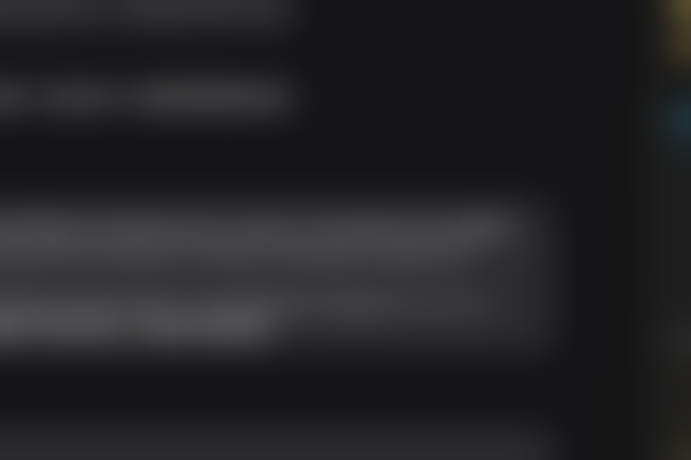
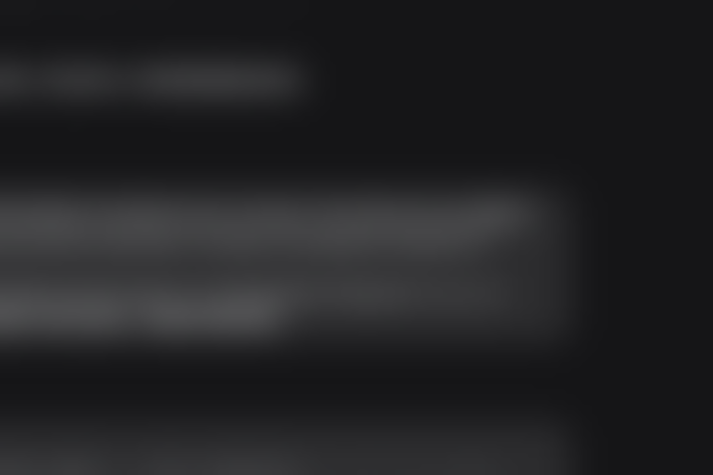
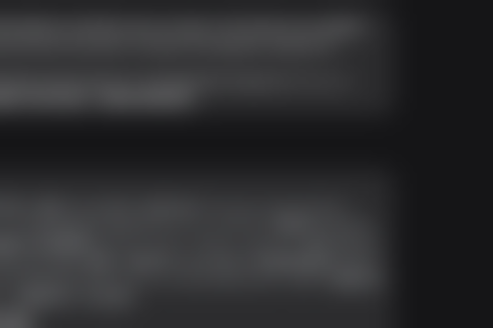

# Acrylic / Mica 调研：可行性、难度与代价

日期：2026-11-09  
范围：Pegline 当前所有玻璃表面（line 卡片、操作胶囊、取色胶囊、flight 卡片、hover preview、拖拽 ghost、标注编辑器卡片与五个胶囊、笔记编辑器边框）。  
结论先行：**能做，但不建议“全量铺开”。** 系统级 Mica/Acrylic 不适合 Pegline；唯一可用的实时逐表面路线是 Windows.UI.Composition 的 host backdrop，代价是引入第二套合成栈、线程模型改造和未测的 GPU 成本。真正值得做的只有大表面（preview、编辑器），4 DIP 卡片边框做 blur 基本看不见。

> **2026-11-09 实现更新：** 最终没有走 WUC，而是采用壁纸派生的 L1 材质（解码壁纸 + 模糊 + 着色 + 屏幕空间采样），铺到所有有填充玻璃的表面；它不采样实时窗口，但零新依赖、Win10 可用。实现、测量和边界见 `docs/DECISIONS.md` D12、`PLAN.md` §11。本文保留调研时的判断与实测数据。

---

## 1. 结论摘要

| 方案 | 能否逐表面 | 是否实时采样窗口后内容 | Pegline 可用性 | 结论 |
|---|---|---|---|---|
| `DWMWA_SYSTEMBACKDROP_TYPE`（Mica / Desktop Acrylic） | 否，整窗 | Mica 只采样壁纸；Acrylic 采样桌面+窗口 | 无激活窗口会回退为纯色；Win11 22H2+；会盖住整条 6016×420 | **不可用** |
| WinUI `SystemBackdropElement`（WinAppSDK 2.0） | 是 | 是（OS 合成器） | 需要 WinUI/WinAppSDK 运行时，违背现有架构 | **不采用** |
| WUC `CreateHostBackdropBrush` | 是（逐 Visual） | 是，窗口后面的实时内容 | 实测可在无激活、无重定向、layered、click-through、圆角裁剪下工作 | **唯一可行的实时 Acrylic 路线** |
| WUC `TryCreateBlurredWallpaperBackdropBrush` | 是 | 否，只采样壁纸 | 实测可用；效果接近静态 Mica，不是 Acrylic | 可作为轻量备选 |
| WUC `CreateBackdropBrush` + 自定义 effect graph | 是 | 是（窗口内合成） | 需要手写 `IGraphicsEffectD2D1Interop`、blur/tint/noise，工作量大 | 二期再做 |
| 维持现有平面玻璃 + 细微噪声/高光 | 是 | 否 | 零风险、零新依赖 | **卡片的推荐方案** |

一句话：**Mica 不适合，系统 Acrylic 不适合；WUC host backdrop 可行，但只值得用在大表面上。**

---

## 2. 实测结果（本机，Windows 11 26H2 build 26300，200% DPI）

测试程序在 `%TEMP%\pegline-wuc-probe`，窗口为 1200×800 / 520×360，样式与 line overlay 一致：

`WS_POPUP | WS_EX_NOREDIRECTIONBITMAP | WS_EX_TOOLWINDOW | WS_EX_NOACTIVATE | WS_EX_TOPMOST`，可选 `WS_EX_LAYERED` / `WS_EX_TRANSPARENT`。

| 测试 | 结果 | 说明 |
|---|---|---|
| `wuc-solid`（纯洋红 WUC sprite） | 窗口被洋红填满 | 证明 WUC 合成能在无激活、无重定向窗口上工作 |
| `wuc-host`（host backdrop） | **实时桌面内容被模糊**，文字变成柔和灰块 | 关键正结果：无需激活、无需截图权限、无捕获边框 |
| `wuc-host --layered` | 同样实时模糊 | `WS_EX_LAYERED` 不破坏 host backdrop |
| `wuc-host --transparent` | 同样实时模糊 | 点击穿透样式可用 |
| `wuc-host --rounded` | 同样实时模糊，四角被圆角裁掉 | `CompositionGeometricClip` 对 backdrop 有效 |
| `wuc-mica`（`TryCreateBlurredWallpaperBackdropBrush`） | 只出现壁纸的模糊渐变，不出现前景窗口文字 | 只采样壁纸，效果更像静态 Mica |
| `dwm-acrylic`（attr 3 + 扩展边框） | 纯 `#CCC` 灰底，没有 Acrylic | 无激活/无重定向窗口上系统 backdrop 未渲染；与文档“非激活回退”一致 |
| `dwm-mica`（attr 2） | 后一次测试时桌面已变为壁纸/锁屏，无法区分 | **不作为证据** |

可靠截图（已放入 `docs/research/acrylic-mica/`）：








> 测试限制：只验证了“一个覆盖整个窗口的 sprite”。多个卡片各自用 host backdrop 时，每个 sprite 是否采样自己所在区域、还是共享整窗 backdrop，尚未验证。这是 spike 必须回答的问题。

---

## 3. 为什么系统 Mica / Acrylic 不行

### 3.1 它们都是“整窗”材料

`DwmSetWindowAttribute(hwnd, DWMWA_SYSTEMBACKDROP_TYPE, ...)` 是窗口级属性，不是逐元素属性。Pegline 的 line 是一个 6016×420 的透明窗口，卡片之间是空隙；设置系统 backdrop 会让**整条带子**都铺上 blur/tint，而不是只出现在卡片下面。只这一条就否决了。

### 3.2 Mica 是 opaque 的基底，不是玻璃

Mica 采样壁纸和主题色，作为窗口最底层的不透明背景；它不会让下面的实时窗口透出来。把它放在卡片上，等于把卡片变成“壁纸色的不透明块”，失去玻璃感。

### 3.3 非激活窗口会回退

Pegline 是 `WS_EX_NOACTIVATE`，永远不抢焦点；系统 Mica/Acrylic 在窗口失活时会回退成纯色。实测的 `dwm-acrylic` 灰底与这一点一致。即使它能渲染，用户体验也会是“平时是灰的，点一下才变玻璃”，不可接受。

### 3.4 平台门槛

- 系统 backdrop 需要 Windows 11 22H2（build 22621）以上；项目声明支持 Windows 10 1809+。
- WinUI 的逐元素 `SystemBackdropElement` 需要 Windows App SDK 2.0 运行时，和 `docs/ARCHITECTURE.md` 明确拒绝 WinUI 3/Win2D 的决定冲突。
- `DwmExtendFrameIntoClientArea` 与 DirectComposition 组合还有已知问题：DWM 可能把非客户区画在 DComp 内容之上，结果完全不透明（GPUI #55 的案例）。这也是 Chromium 最终改用 WUC backdrop 的原因之一。

参考：[Acrylic](https://learn.microsoft.com/en-us/windows/apps/design/style/acrylic)、[Mica](https://learn.microsoft.com/en-us/windows/apps/design/style/mica)、[DWM_SYSTEMBACKDROP_TYPE](https://learn.microsoft.com/en-us/windows/win32/api/dwmapi/ne-dwmapi-dwm_systembackdrop_type)、[DWMWINDOWATTRIBUTE](https://learn.microsoft.com/en-us/windows/win32/api/dwmapi/ne-dwmapi-dwmwindowattribute)。

---

## 4. 唯一可行的实时路线：WUC host backdrop

### 4.1 它是什么

`Compositor.CreateHostBackdropBrush()` 返回一个 `CompositionBackdropBrush`，它采样**窗口后面**的桌面内容（包括其他应用窗口），并在窗口合成时作为 brush 使用。对非 UWP Win32 窗口，需要先：

```rust
DwmSetWindowAttribute(hwnd, DWMWA_USE_HOSTBACKDROPBRUSH /* 17 */, &TRUE, 4);
```

然后用 WUC 建一棵合成树：

```text
DesktopWindowTarget
└─ ContainerVisual
   ├─ SpriteVisual  (host backdrop brush, 可加圆角 clip)
   └─ SpriteVisual  (现有 swapchain 的 CompositionSurfaceBrush)
```

这样 D2D 渲染器可以保留：把现有 `CreateSwapChainForComposition` 的 swapchain 通过 `ICompositorInterop::CreateCompositionSurfaceForSwapChain` 包成 `CompositionSurfaceBrush`，放在 backdrop 上面；D2D 继续画文字、描边、图片，卡片内部留透明，让 backdrop 透出来。

参考：[CreateHostBackdropBrush](https://learn.microsoft.com/en-us/uwp/api/windows.ui.composition.compositor.createhostbackdropbrush)、[CreateBackdropBrush](https://learn.microsoft.com/en-us/uwp/api/windows.ui.composition.compositor.createbackdropbrush)、[TryCreateBlurredWallpaperBackdropBrush](https://learn.microsoft.com/en-us/uwp/api/windows.ui.composition.compositor.trycreateblurredwallpaperbackdropbrush)、[Chromium 的 WUC backdrop 迁移](https://chromium-review.googlesource.com/c/chromium/src/+/6512200)。

### 4.2 优点

- **逐 Visual**：可以只放在卡片、胶囊、preview 下面，不覆盖空隙。
- **实时**：采样窗口后的其他应用，不需要 `BitBlt`、不需要屏幕捕获权限、没有捕获边框。
- **不要求激活**：实测无激活窗口可用；这对 Pegline 是决定性的。
- **兼容现有窗口样式**：`WS_EX_NOREDIRECTIONBITMAP`、`WS_EX_LAYERED`、`WS_EX_TRANSPARENT`、圆角裁剪都验证过。
- **保留 D2D 代码**：只替换“swapchain 怎么挂到窗口上”，不重写渲染器。

### 4.3 代价与限制

1. **Windows 11 22000+**：`DWMWA_USE_HOSTBACKDROPBRUSH` 是 Win11 属性；Win10 必须回退到现有平面玻璃。
2. **固定模糊半径**：host backdrop 自带一个“安全模糊”，API 不暴露半径；想要 Fluent 标准的 blur 30 + tint + noise，需要 `CreateBackdropBrush` + 自定义 effect graph，工作量和风险都高一个量级。
3. **GPU 成本未知**：backdrop blur 由合成器做，`probe` 当前的 draw p50 0.80 ms 不包含这部分；在 Intel Arc B390 iGPU + 6016×420 上必须实测。
4. **线程/公寓模型**：`Compositor` 绑定 DispatcherQueue；现有 render thread 没有消息循环（`src/window/overlay.rs:332` 的 `'outer: loop` 阻塞在 `rx.recv`）。要么把合成放到 UI 线程，要么新建专用 composition 线程；每帧跨线程更新要避免堆分配。
5. **多表面语义未验证**：host backdrop brush 在多个不同位置的 sprite 上是否各自采样正确区域，还是共享整窗纹理，尚未测。
6. **策略不自动生效**：自定义 brush 不会像系统 Acrylic 那样自动响应“透明效果关闭 / 节电模式 / 高对比度 / 远程桌面”；这些要自己查 `UISettings.AdvancedEffectsEnabled`、`PowerManager.EnergySaverStatus` 等，并做 fallback。
7. **视觉对比度**：当前玻璃是 72% 白（`#B8F7F7F7`）。如果保留这个填充，blur 几乎看不见；如果降到 20–40% 让 blur 透出来，文字对比度就要重新设计，深色壁纸/亮色窗口下可能更差。

---

## 5. 逐个表面的收益评估

卡片几何：144×112 DIP，圆角 16，4 DIP 白色环包着 136×104 图片。4 DIP 在 200% 下是 8 物理像素；blur 在这么窄的环里没有足够空间表现，基本只会变成“脏一点的白色”。

| 表面 | 玻璃面积 | Acrylic 可见度 | 实现成本 | 建议 |
|---|---|---|---|---|
| line 卡片边框 | 4 DIP 环 | **几乎为零** | 每卡片一个 backdrop sprite；多表面语义待验证 | 保持现状 |
| 操作胶囊（Annotate/Open） | 小圆角矩形 | 低—中 | 与卡片同一窗口，可共用 backdrop | 二期可选 |
| 取色胶囊 | 小圆角矩形 | 低—中 | 同上 | 二期可选 |
| hover preview | 大面板 | **高** | 一个独立窗口，一个 backdrop sprite | **优先 spike** |
| flight 卡片 | 4 DIP 环，且飞行中 | 几乎为零 | 每帧移动的 sprite，成本/收益差 | 不做 |
| 拖拽 ghost | 4 DIP 环 | 几乎为零 | 同上 | 不做 |
| 标注编辑器卡片 | 4 DIP 环 | 低 | 编辑器已有独立窗口，可共用 | 低优先级 |
| 标注编辑器五个胶囊 | 小圆角矩形 | 中 | 同一 swapchain 内，一个 WUC target 即可 | 二期可选 |
| 笔记编辑器边框 | 4 DIP 环 | 几乎为零 | 同卡片 | 不做 |

**“所有玻璃表面”这个目标本身不成立**：真正能看出 Acrylic 的只有 preview 和少数较大的胶囊；卡片边框无论用多好的 blur，视觉上都接近现在的白色描边。

---

## 6. 技术难度与改造点

### 6.1 代码改造面

- `src/gfx/device.rs`：`create_composition`（90–126 行）目前建 `IDCompositionDevice` + `CreateTargetForHwnd` + root visual；`create_swap_chain`（133–166 行）建 flip-sequential swapchain。需要增加 WUC 版本：`CreateDispatcherQueueController` → `Compositor` → `ICompositorDesktopInterop::CreateDesktopWindowTarget` → `DesktopWindowTarget.SetRoot`，并用 `CreateCompositionSurfaceForSwapChain` 挂 swapchain。
- `src/render/mod.rs`：`Renderer::new`（408 行）持有 `_dcomp/_visual/_target`；`attach_content`（498 行）调用 `_visual.SetContent(&content)` + `_dcomp.Commit()`。这里要抽象成两种 backend，或整体替换为 WUC surface brush。
- 所有窗口（line、flight、preview、ghost、annotation editor、note editor）都走这套；迁移是“全窗口”的，不能只改一个表面，除非做双栈。
- 标注编辑器的五个胶囊在同一个窗口/swapchain 里（`src/editor/window/mod.rs:210–229`），所以一个 WUC target 就够，不需要每胶囊一个窗口。

### 6.2 线程模型

这是最大的隐性成本。WUC 不是“随便哪个线程调一下”的 API：

- 方案 A：**UI 线程合成**。UI 线程已有消息循环，适合 `DispatcherQueue`；但 swapchain 目前在 render thread 创建和 `Present`。需要把 `CreateCompositionSurfaceForSwapChain` 放到 UI 线程，并处理 COM 跨公寓；render thread 继续 `Present`。每帧不需要 WUC 调用，理论上可行，但要验证。
- 方案 B：**专用 composition 线程**。该线程建 `DispatcherQueueController` + `Compositor` + target，跑消息循环；render thread 只负责 D3D/D2D 和 `Present`。跨线程传递 surface/尺寸变化，注意不要每帧分配。
- 方案 C：把合成也搬到 render thread，在阻塞循环里插入 `DispatcherQueue` 消息泵。改动最大，容易破坏现有“UI 线程不阻塞”的规则。

建议 spike 先做 A；如果 `CreateCompositionSurfaceForSwapChain` 的公寓/线程约束过不去，再评估 B。

### 6.3 与现有 DComp 的关系

一个 HWND 只能有一个 composition target。迁到 WUC 后，该窗口不能再同时用 `IDCompositionDevice` 的 target；需要把 `Renderer` 的 DComp 路径替换掉，而不是叠加。其他窗口可以继续用 DComp，但两套代码并存会增加维护成本。

### 6.4 视觉实现

- 最省事：host backdrop sprite + 现有 D2D 内容，把卡片内部的白色填充改成低 alpha 的 tint（例如 10–25% 白）和更明显的 1 DIP 内描边。
- 要 Fluent 标准：需要 `CreateBackdropBrush` + `GaussianBlurEffect` + 颜色混合 + 噪声。Win32Acrylic 的现代配方是 blur 30、亮度色 `{0.125,0.125,0.125,0.8}` COLOR 混合、tint `{0.125,0.125,0.125,0.4}` LUMINOSITY 混合、噪声 0.02 乘算；噪声是 256×256 `R16G16B16A16Float`，从 `Windows.UI.Xaml.Controls.dll` 资源 2000 加载。这个配方需要自定义 `IGraphicsEffectD2D1Interop`，`windows` 0.62 有接口（`Win32_System_WinRT_Graphics_Direct2D`），但要手写 unsafe COM，属于二期。
- 如果只是想要“更像 Fluent 的质感”，在现有 D2D 里加一层很淡的噪声/内高光，成本几乎为零，风险也低。

参考：[Win32Acrylic](https://github.com/ALTaleX531/Win32Acrylic)。

---

## 7. 代价估算

以下是工程估算，不是实测数字；标注“未测”的项目必须在 spike 里补。

| 项目 | 估算 | 说明 |
|---|---|---|
| 可行性 spike（line 一个卡片 + preview） | **2–3 人日** | 复用现有 probe；只验证 WUC target + swapchain + host backdrop + 性能 |
| 生产级 WUC 合成层 | 5–8 人日 | 新 backend、窗口迁移、线程模型、错误处理 |
| 逐表面接入与布局 | 3–5 人日 | preview、编辑器、胶囊；卡片可跳过 |
| fallback / 策略检测 | 2–3 人日 | Win10、透明效果关闭、节电、高对比度、RDP |
| 视觉调校与多环境验证 | 3–5 人日 | 深/浅壁纸、亮/暗应用、200% DPI、多显示器、120 Hz |
| 自定义 Acrylic effect graph（可选） | +8–12 人日 | 手写 COM effect、tint/noise、调试 |
| **合计（不含自定义 effect）** | **约 2–3 周** | 一人；不含返工 |
| 二进制 | +50–200 KB（未测） | 只加 `windows` features，无新运行时 |
| 内存 | 未测，预计 +5–20 MB | WUC 合成器/纹理；当前 92 MB 基线 |
| GPU / 帧时间 | **未测，最大风险** | iGPU + 6K；可能吃掉 8.3 ms 预算的显著部分 |
| OS 支持 | Win11 22000+ 增强；Win10 平面回退 | 系统要求不变 |
| 维护成本 | 中—高 | DComp + WUC 两套栈，线程/公寓约束 |

**最大的未知不是“能不能画”，而是“在 Intel Arc B390 iGPU、6016×420、60/120 Hz 下，host backdrop 的合成成本是多少”。** 这必须在 spike 里用 `probe` 的帧时间、GPU busy 和实际观感来回答；没有数字之前不应承诺全量实现。

---

## 8. 建议路线

### 第一步：2–3 天 spike（只做验证，不合并）

1. 在 `pegline-wuc-probe` 里加一个和 line 同尺寸的 WUC 窗口，挂现有 swapchain surface，放 1–3 个 host backdrop sprite。
2. 测：
   - 多 sprite 是否各自采样正确区域（这是当前最大的语义空白）。
   - 60 Hz / 120 Hz 下帧时间、GPU busy、内存。
   - 无激活、click-through、layered、圆角、200% DPI、多显示器。
   - 桌面/浏览器/视频/纯色背景下的可读性。
3. 用同一套 D2D 内容做 A/B：现有 72% 白玻璃 vs 低 alpha tint + host backdrop。
4. 通过标准：稳定 60 fps（p95 ≤ 16.7 ms）、合成+绘制 ≤ 2 ms、内存 +≤ 15 MB、视觉上明显更好。任一不达标就停。

### 第二步：只做大表面

如果 spike 通过，先接 **hover preview**（收益最高、窗口独立、面积大）和 **标注编辑器背景**；line 卡片保持现有平面玻璃。这样用户能感知到材质变化，又不用为 4 DIP 环付出全量迁移成本。

### 第三步：再评估胶囊

操作胶囊/取色胶囊/编辑器胶囊可以共用所在窗口的 WUC target；如果 preview 的方案稳定，再接这些。卡片、flight、ghost、笔记边框不建议做。

### 不推荐

- 不要用 `DWMWA_SYSTEMBACKDROP_TYPE`：整窗、非激活回退、Win11 only，和 Pegline 的透明 overlay 根本冲突。
- 不要用 Mica：opaque，且只采样壁纸，放在卡片上不是玻璃。
- 不要一上来做自定义 effect graph：先把 host backdrop 的成本和观感测清楚；固定模糊可能已经够用。
- 不要为了“所有表面”而降低卡片文字对比度；4 DIP 环的 blur 投入产出比接近零。

---

## 9. 待回答的问题

1. 多个 host backdrop sprite 在同一窗口内是否各自采样正确区域？
2. `CreateCompositionSurfaceForSwapChain` 能否跨线程（render thread 建 swapchain，UI 线程建 WUC surface）？公寓模型如何？
3. host backdrop 的合成成本在 6016×420、iGPU、60/120 Hz 下是多少？
4. 固定模糊半径在 200% DPI 下看起来是否足够“Fluent”，还是必须自定义 effect？
5. Win10 上除了平面回退，是否有可接受的近似（例如 `TryCreateBlurredWallpaperBackdropBrush` 不可用时的静态 tint）？
6. 透明效果关闭 / 节电模式 / 高对比度 / RDP 下的 fallback 策略和观感。
7. 用户是否接受“只有大表面有材质，卡片仍然是平面玻璃”的范围收缩？

---

## 10. 附：测试环境

- Windows 11 26H2，build 26300；深色主题；透明效果开启。
- Xiaomi Book Pro 14，Intel Arc B390 iGPU，32 GB RAM，6016×3384 @200%，60 Hz。
- 探针：`%TEMP%\pegline-wuc-probe`（未纳入仓库）；本文截图在 `docs/research/acrylic-mica/`。
- 现有玻璃：`src/render/mod.rs:92-95` `Brush::Glass` / `GlassLit`，`src/render/mod.rs:337-338` 颜色，`src/render/mod.rs:679` 描边。
